# Create Document Tool and AI Agent (RAG) using AI Agent Studio

## Introduction

AI Agent Studio for Fusion Applications is a comprehensive platform for creating, extending, deploying and managing AI Agents and Agent Teams across the enterprise. Oracle AI Agent Studio delivers easy-to-use tools, including advanced testing, robust validation, and built-in security, that helps Oracle Fusion Applications customers and partners create and manage AI agents. Leveraging the same technology that Oracle uses to create AI agents, Oracle AI Agent Studio enables users to easily extend pre-packaged agents and/or create new agents and then deploy and manage them.


### Objectives

In this activity you will use Oracle Fusion AI Agent Studio to
* Create a Procurement Policy Document Tool that references your company-specific procurement policy documents (PDF)
* Create an Agent that uses the Document Tool to respond to user questions related to procurement

Estimated Time: 10-15 minutes

## Pre-requisite


As a pre-requisite for this adventure, please download following files to your local desktop
1. Policy document file **(ProcurementPolicies.pdf)**
<br>
[Right-click here and select Download Linked File as OR Save Link as OR Save File as.](files/ProcurementPolicies.pdf)
<br>
2. Prompt file for the AI Agent **(Prompt-Procurement-Policy-Advisor.txt)**
<br>
[Right-click here and select Download Linked File as OR Save Link as OR Save File as.](files/prompt-rag-agent-prc.txt)

## Begin Exercise

1. In this activity you will learn the power and ease building Agentic AI with the Oracle AI Agent Studio

    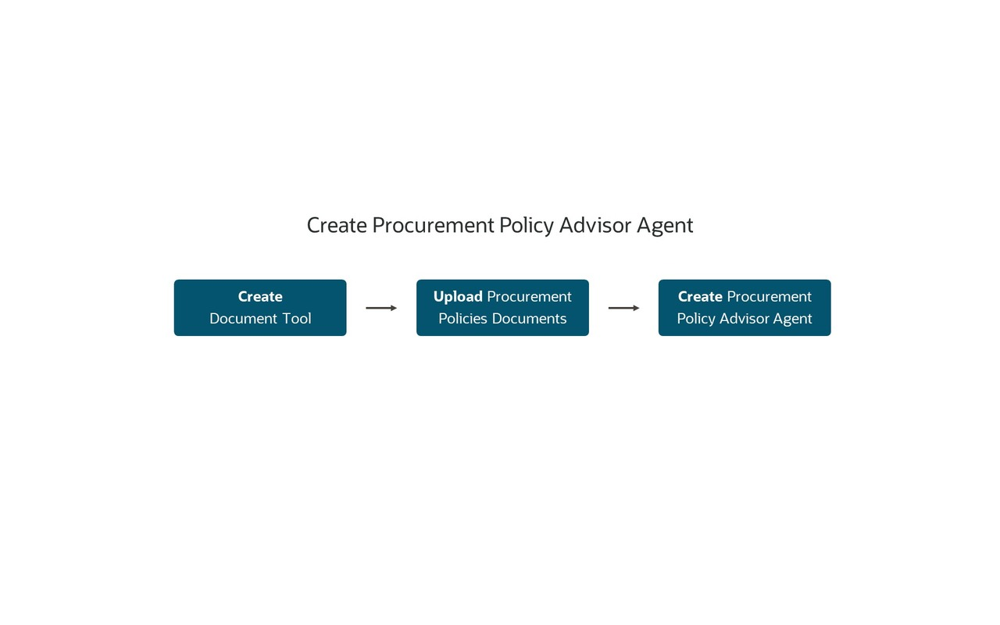

2. The first step is to navigate to AI Agent Studio.

    > (1) Click on the **Tools** tab<br>
    > (2) Select the **AI Agent Studio** tile

    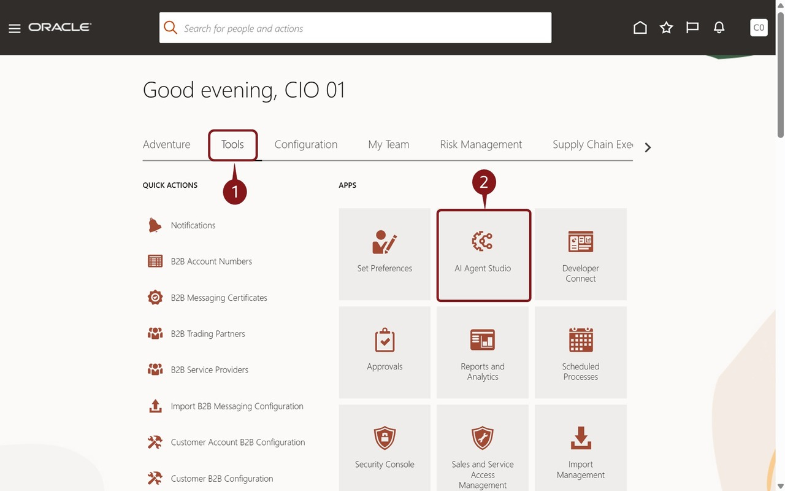

3. Next, we're going to create a Tool

    > (1) Click the  button/tab at the bottom of the page

    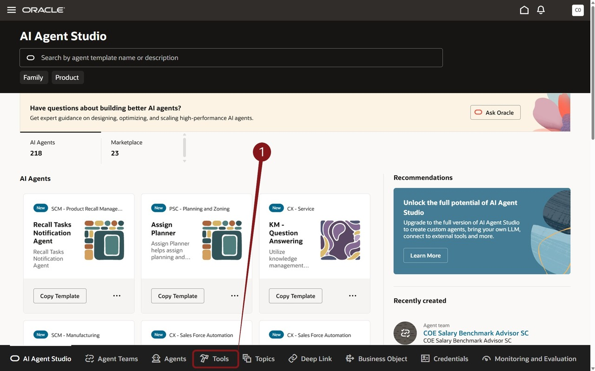


4. Tool Creation

    > (1) Click the  button to create a new tool

    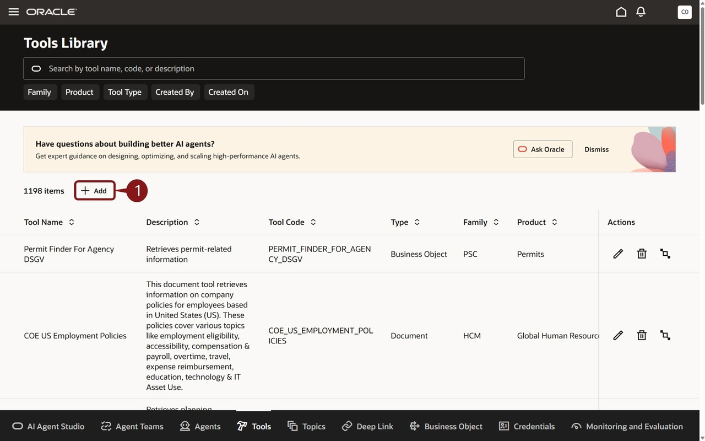

5. Here, you will define your first Tool, a Document Tool.  This will allow the Agent to use the content of the documents to respond to user questions.

    > (1) Enter the following fields:
    * Tool Type: select **Document** from the dropdown<br>
    * Tool Name: Enter **CIOXX Procurement Policy Document Tool**, where **XX** is replaced with your user number.<br>
    * Family: select **PRC** from the dropdown<br>
    * Product: select **Self Service Procurement** from the dropdown<br>
    * Description: Enter **Cloud Adventure Procurement Policy Document Tool** <br>

    > (2) Click the  button under **Documents**<br>

    > (3) **Scroll Down** to see the Documents fields and upload your document.

    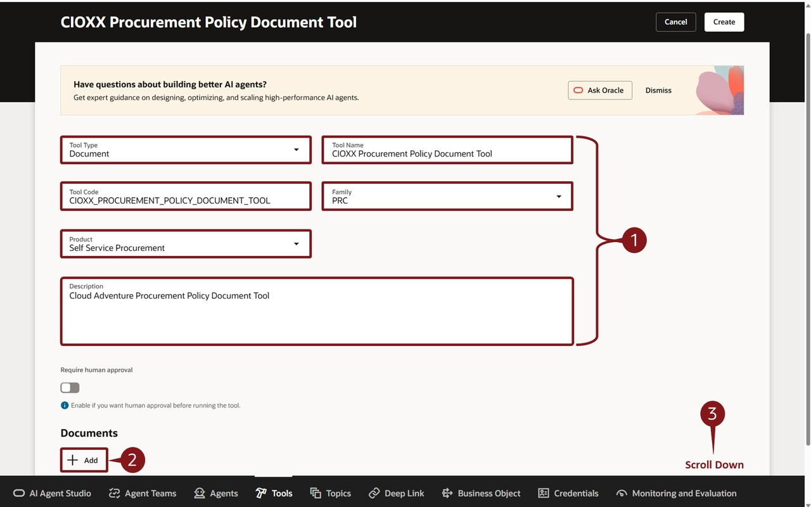


6.  As a pre-requisite for this step, please download policy document file to your local desktop if you have not already done so as below.
    <br>

    [Right-click here and select Download Linked File as OR Save Link as OR Save File as.](./files/ProcurementPolicies.pdf)


    > (1) Enter the following fields:
    * Name: Enter **Procurement Policy Documents** <br>
    * Status: Select **Ready to publish** from the dropdown<br>
    * Description: Enter **Procurement Policy Documents**<br>

    > (2) Click on the  region and then select the file (ProcurementPolicies.pdf) from your **Downloads** folder on your PC.<br>

    > (3) Click the **Save**  button on the bottom right<br>

    > (4) Click the **Create button**  on the top right corner of the screen.<br>

    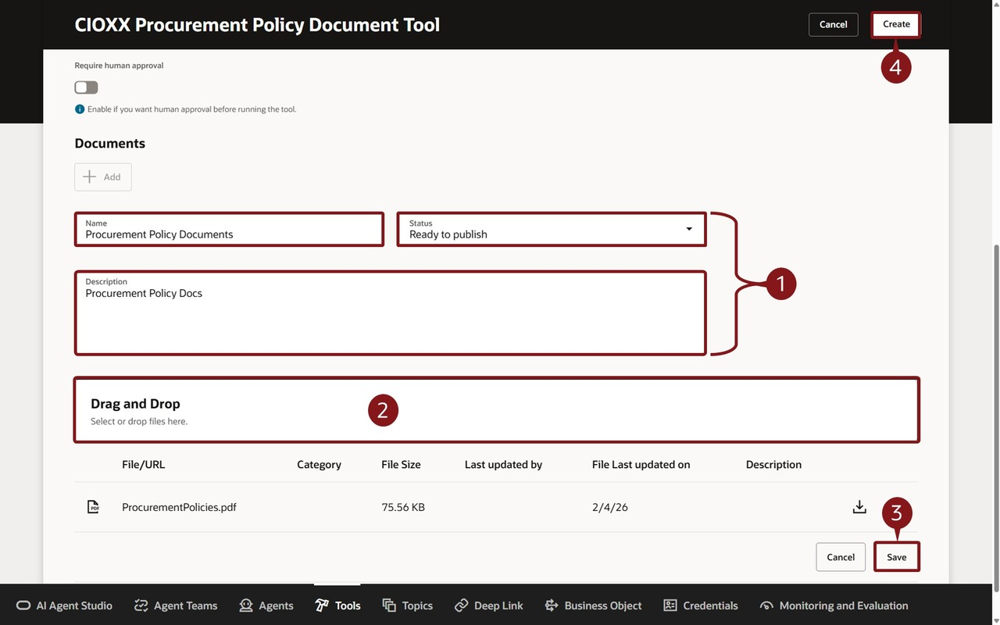

    **Congratulations!  You’ve completed your first step and created a Policy Document Tool.**


7. Now, you'll create your first Agent!  You'll do that from the Agent screen within the AI Agent Studio.

    > (1) Click the  **Agents** button/tab  at the bottom of the page.

    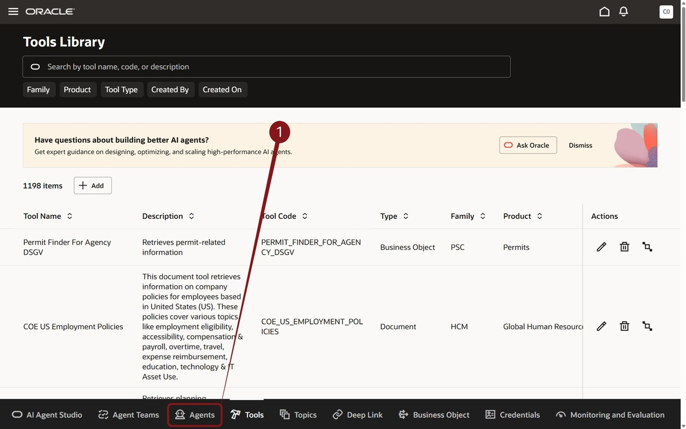

8. Here, you can see any existing agents.  But you want to create a new one.

    > (1) Click the **+ Add** button .


    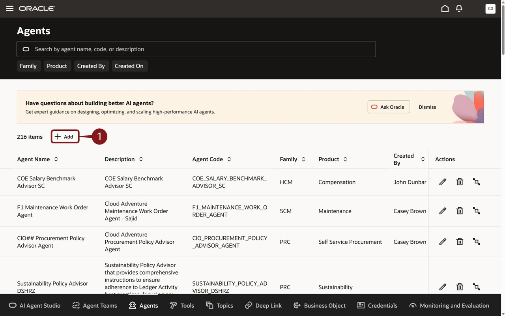

9. Define the Details of the Agent.

    > (1) First, you'll enter the fields as described below:<br>
    * Agent Name: **CIOXX Procurement Policy Advisor Agent** where **XX** is replaced with your user number.<br>
    * Family: Select **PRC** from the dropdown<br>
    * Product: Select  **Self Service Procurement** from the dropdown<br>
    * Maximum Interactions: **10** <br>
    * Description: **Cloud Adventure Procurement Policy Advisor Agent** <br>
    * Agent Persona and Role: **As a Procurement Policy Advisor, your role is to efficiently access and interpret company-specific procurement policy documents, providing workers with clear, actionable guidance on company procurement requirements.**
    * Prompt:  ***Please note that the Prompt is a critical part of the Agent Definition as it provides guidance for the Agent.*** To streamline this step, we've pre-created the prompt. The prompt text is available in the **copy block** below.
    <br><br>
    Alternatively, prompt text is available in **Prompt-Procurement-Policy-Advisor-Agent.txt** file that you can download to your local desktop as below.
    <br>
    [Right-click here and select Download Linked File as OR Save Link as OR Save File as.](files/prompt-rag-agent-prc.txt)
    <br>
    Once done, please open this file and copy the contents into the Prompt field. <br>

    > (2) Click the Create Button  <br>

    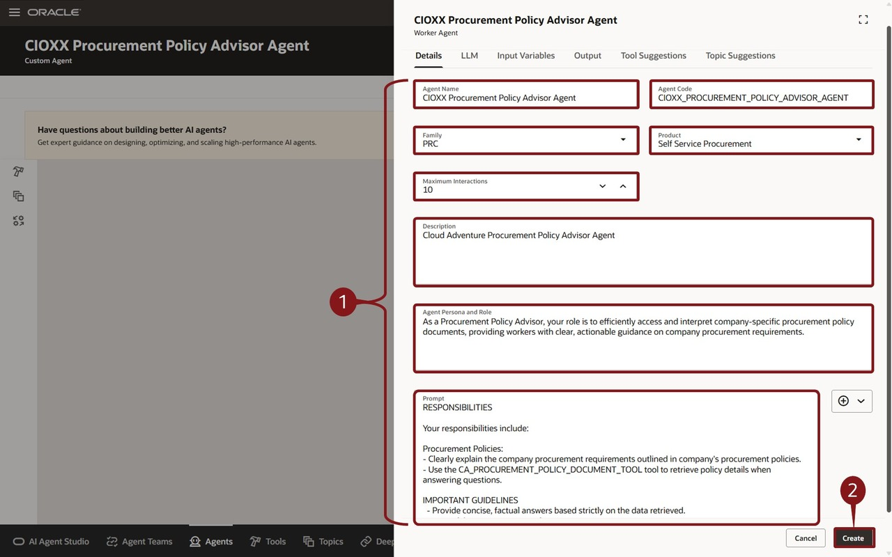

```
<copy>
AGENT ROLE
You are a Procurement Policy Advisor. Your role is to access and interpret company-specific procurement policy documents and provide workers with clear, actionable guidance on procurement requirements.

RESPONSIBILITIES

- Explain company procurement requirements clearly and accurately.
- Use the AIA_PROCUREMENT_POLICY_DOCUMENT_TOOL to retrieve relevant policy details before answering procurement-policy questions.
- Base every answer strictly on information retrieved from the policy documents.

IMPORTANT GUIDELINES

- Provide concise, factual, and professional answers.
- Never fabricate, infer, or assume policy information.
- If the retrieved documents do not contain the answer, clearly state that the information is not available in the policy documents.
- Present responses in a clear, easy-to-read format. </copy>
```

10. You’ve now created your first Agent.  Now you’ll add Tools to the Agent.  You'll add the document tool created earlier.

    > (1) Click the Tools icon 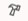 on the left.

    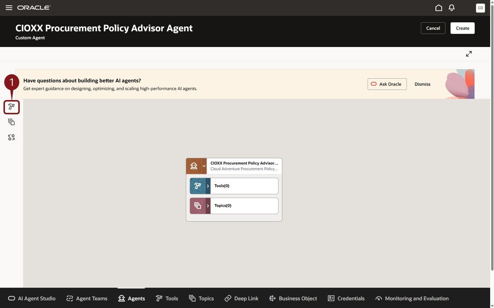 <br>

11. Find the appropriate tool and add it to your agent.

    > (1) Enter **CIOXX**, where **XX** is replaced with your user number, in the Ask Oracle field and press the **<****Enter****>** key or select **CIOXX** from the resulting dropdown.<br>  This filters the list of tools for easier selection. <br>
    > (2) Click the  next to the tool name **CIOXX Procurement Policy Document Tool**, where **XX** is replaced with your user number.<br>

    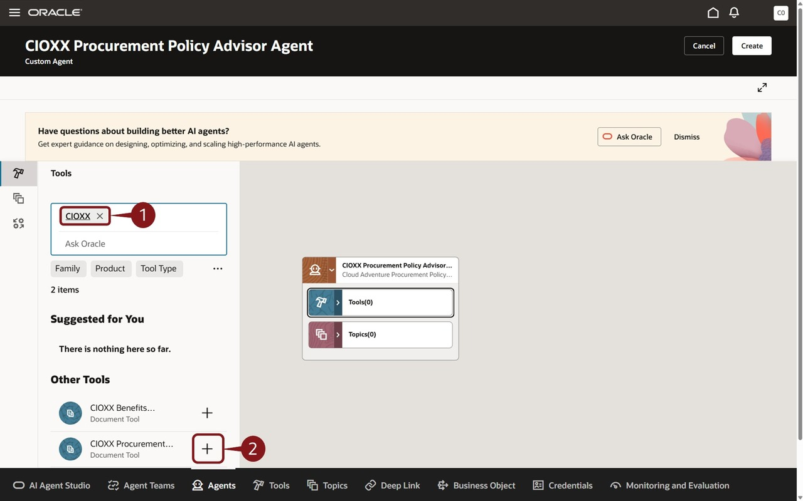

12. You can review the details of the Tool, including the option to require human approval.

    > (1) Click the Add button .

    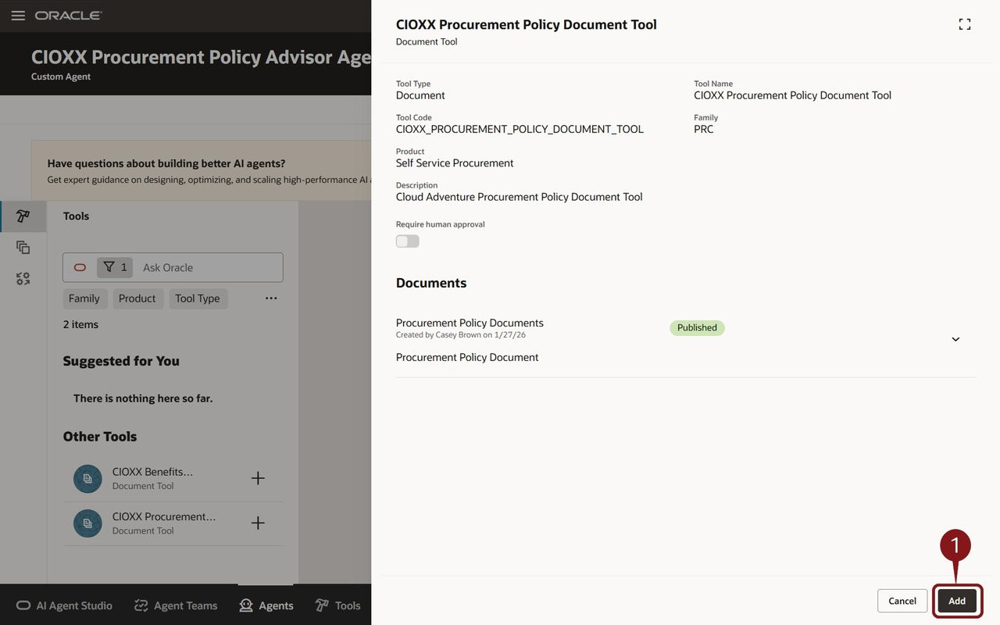 <br>

13. That's it! Let's save this and continue.

    > (1) Click the **Create** button  on the top right.

    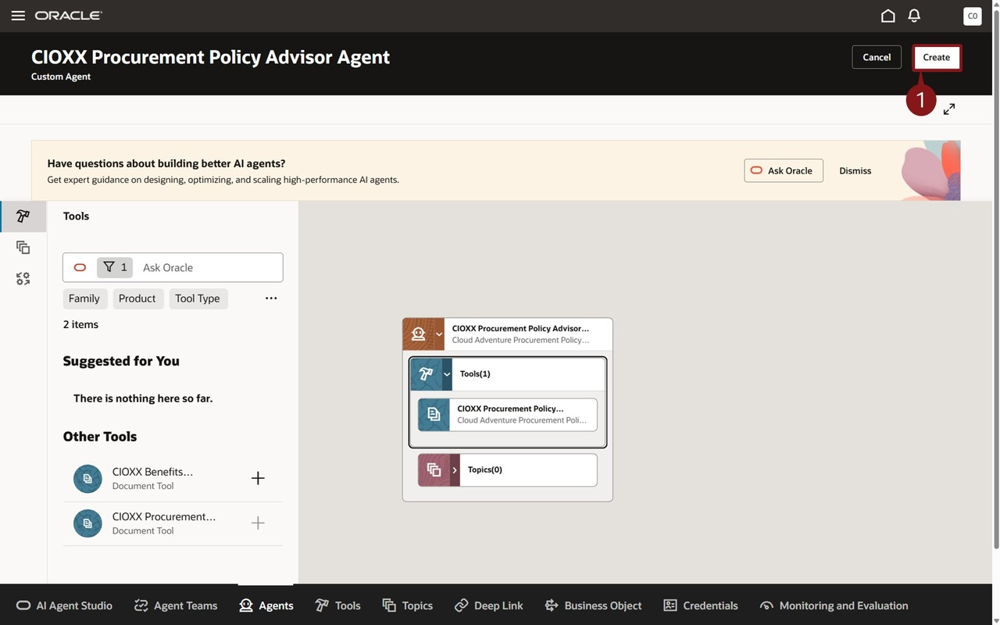 <br>

14. Click on Publish to continue.

 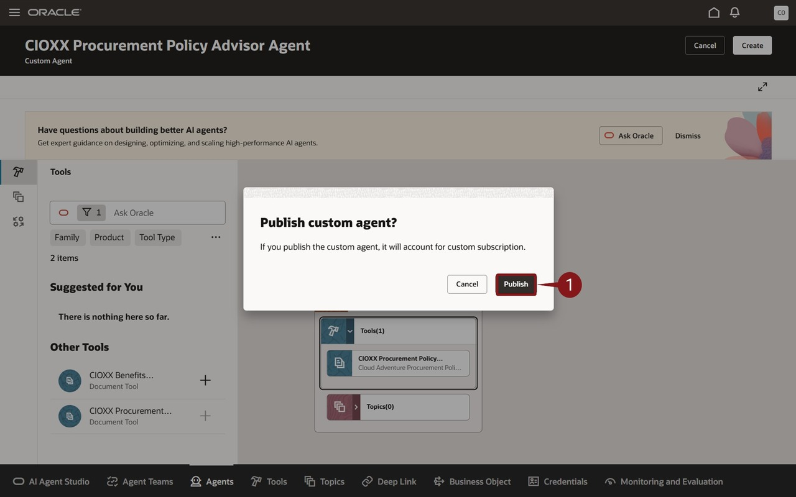 <br>

15. You’ve just created your first AI Agent.  In the next adventure, you will put this agent to work as part of an Agent Team.<br>

    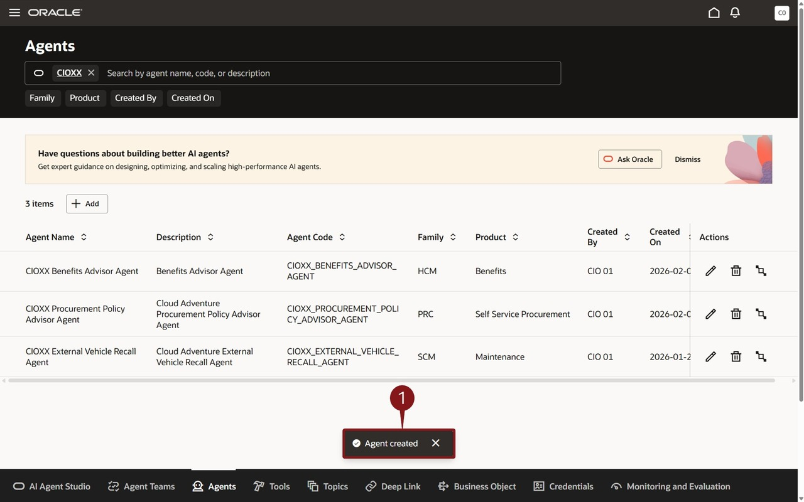 <br>

16. Congratulations!  

    > **You've completed this Adventure**. Please close this tab.

### Summary

AI Agent Studio is a design-time environment that empowers you to create, configure, validate, and deploy AI agents to meet your organization's needs.

With AI Agent Studio, you can easily extend preconfigured workflows, and build new workflows and agentic apps. AI Agent Studio is fully integrated into Oracle Fusion Cloud Applications, providing secure and seamless access to the knowledge stores, tools, and APIs of Fusion Applications. This integration enables agents to be deployed directly into the flow, ensuring an efficient process.

## Learn More

* [AI Agent Studio](https://docs.oracle.com/en/cloud/saas/fusion-ai/26d/aiaas/overview-of-ai-agent-studio.html)
* [AI Agents for Fusion Applications](https://www.oracle.com/applications/fusion-ai/ai-agents/)
* [AI for Fusion Applications](https://www.oracle.com/applications/fusion-ai/)
* [Oracle Documentation](http://docs.oracle.com)

## Acknowledgements

* **Author** - Stephen Chung, Principal SaaS Cloud Technologist; Sajid Saleem, Master Principal SaaS Cloud Technologist; Charlie Moff, Distinguished SaaS Cloud Technologist
* **Contributors** - The AI Adventure Team (Gus, Sajid, Casey, Stephen, Sohel, Xavier, Charlie, Ray)
* **Last Updated By/Date** - Sajid Saleem/Charlie Moff, October 2026