# Create an Agent Workflow for an Agentic App

## Introduction

AI Agent Studio for Fusion Applications is a comprehensive platform for creating, extending, deploying and managing AI Agents and Agent Teams across the enterprise. Oracle AI Agent Studio delivers easy-to-use tools, including advanced testing, robust validation, and built-in security, that helps Oracle Fusion Applications customers and partners create and manage AI agents. Leveraging the same technology that Oracle uses to create AI agents, Oracle AI Agent Studio enables users to easily extend pre-packaged agents and/or create new agents and then deploy and manage them.

### Objectives

Create an Agent Workflow that can be used as part of an Agentic App.  This lab will create a workflow that leverages Sales Orders from the Order Management module or Oracle SCM Cloud.

In this activity you will use Oracle Fusion AI Agent Studio to
* Create an Agent Workflow using a copy of a partially completed workflow.
* Review the pre-created workflow node that leverages the Policy document as code capability.
* Add Business Object and LLM nodes to access Sales Order transactions ad format output.

Estimated Time: 10-15 minutes

## Predefined Copy Blocks


****Please Note**** This adventure requires the entry of a User Prompt and an Output Specifications. To streamline typing and eliminate any typing errors, these are shown in-line in the guide below and also available in the copy blocks below.<br><br>
**User Prompt for Select Fields node**:
```
<copy>
Based on the output from {{$context.$nodes.GET_SALES_ORDER_SUBMITTED.$output}}, extract a list of sales orders with columns for Sales Order#, Business Unit Name, Sold-To-Customer, Sales Order Amount based on sum of lines amount, sales order status and submittedDate in the format of YYYY-MM-DD. 

Set riskLevel to "" for each sales order
</copy>
```
**Output Specification for Select Fields node**:
```
<copy>
{
  "$schema": "http://json-schema.org/draft-07/schema#",
  "type": "object",
  "properties": {
    "orders": {
      "type": "array",
      "items": {
        "type": "object",
        "properties": {
          "salesOrderNumber": {
            "type": "string"
          },
          "businessUnitName": {
            "type": "string"
          },
          "soldToCustomer": {
            "type": "string"
          },
          "salesOrderAmount": {
            "type": "string"
          },
          "orderStatus": {
            "type": "string"
          },
          "submittedDate": {
            "type": "string"
          },
          "riskLevel": {
            "type": "string"
          }
        },
        "required": [
          "salesOrderNumber",
          "businessUnitName",
          "soldToCustomer",
          "salesOrderAmount",
          "orderStatus",
          "submittedDate",
          "riskLevel"
        ],
        "additionalProperties": false
      }
    }
  },
  "required": [
    "orders"
  ],
  "additionalProperties": false
}
</copy>
```
**User Prompt for Prepare Output node**:
```
<copy>
{
  "$schema": "http://json-schema.org/draft-07/schema#",
  "type": "object",
  "properties": {
    "orders": {
      "type": "array",
      "items": {
        "type": "object",
        "properties": {
          "salesOrderNumber": {
            "type": "string"
          },
          "businessUnitName": {
            "type": "string"
          },
          "soldToCustomer": {
            "type": "string"
          },
          "salesOrderAmount": {
            "type": "string"
          },
          "orderStatus": {
            "type": "string"
          },
          "submittedDate": {
            "type": "string"
          },
          "riskLevel": {
            "type": "string"
          }
        },
        "required": [
          "salesOrderNumber",
          "businessUnitName",
          "soldToCustomer",
          "salesOrderAmount",
          "orderStatus",
          "submittedDate",
          "riskLevel"
        ],
        "additionalProperties": false
      }
    }
  },
  "required": [
    "orders"
  ],
  "additionalProperties": false
}
</copy>
```
## Begin Exercise

1. Assemble an AI Agent Team, Debug and Test


    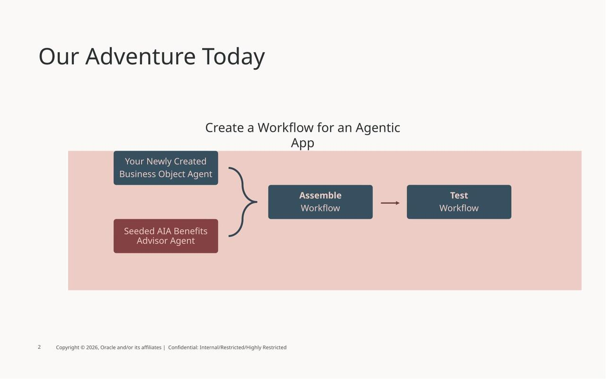

2. Open AI Agent Studio

    > (1) Click the **Tools** menu tab<br>

    > (2) Click the **AI Agent Studio** tile


    

3. Expand Menu

    > (1): Hover your mouse over the **Oracle** Icon. <br>

    > (2): Click on the **Pin** Icon to expand the menu.


    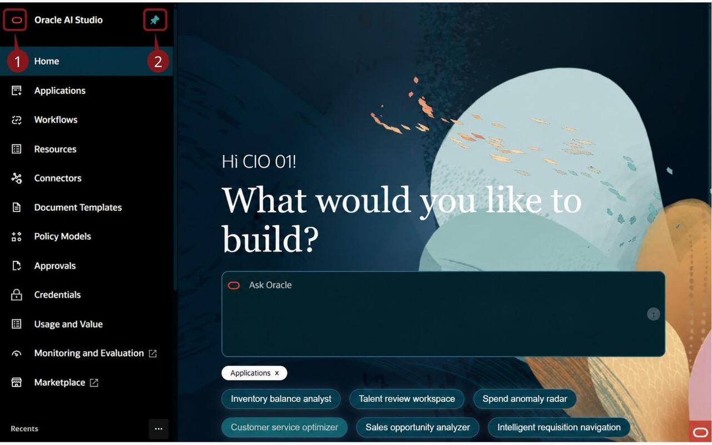

4. Open Workflows

    > (1) Click the **Workflows** Menu Option


    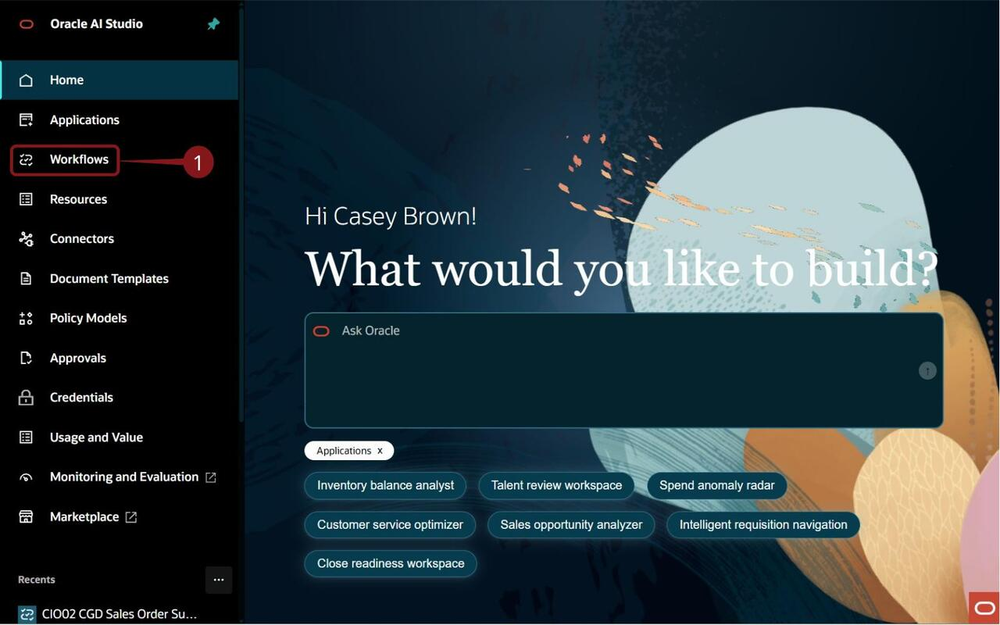

5. You’ll now create a workflow that will eventually be leveraged by an Agentic App in a future lab.  We’ve created a workflow template with a couple of pre-defined steps to save time.  You’ll make a copy of that template and add additional nodes.

    > (1) Type **AIAT** in the Search field and press the **<Enter>** key.<BR>

    > (2) Look for the Workflow named **AIAT Sales Order Workflow** and click the **Duplicate** icon in on the right side of that row.

    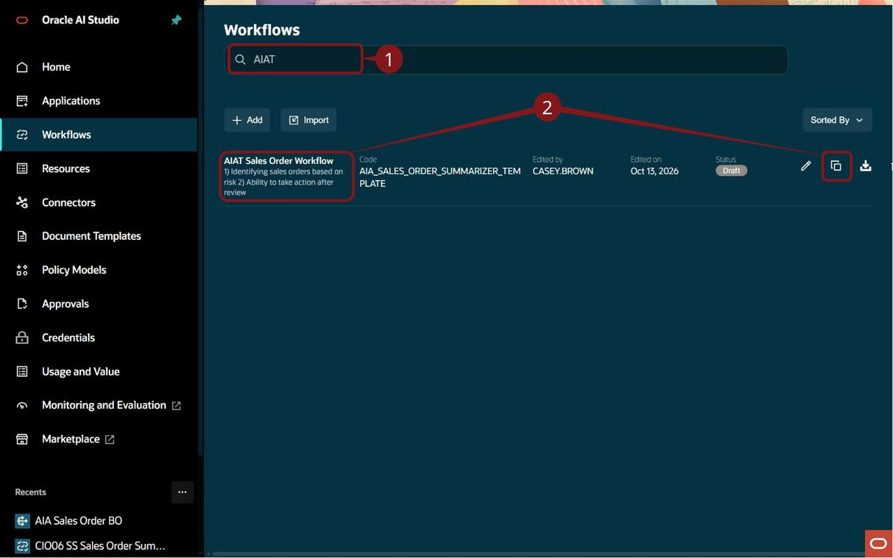

6. Workflow Settings: Details

    > (1) Enter **CIOXX YYY Sales Order Workflow** in the Name field, where XX is replaced with your user number and YYY is replaced with your initials.  You can completed replace the field name or edit the existing field.<BR>


    > (2) Click on **Create**


    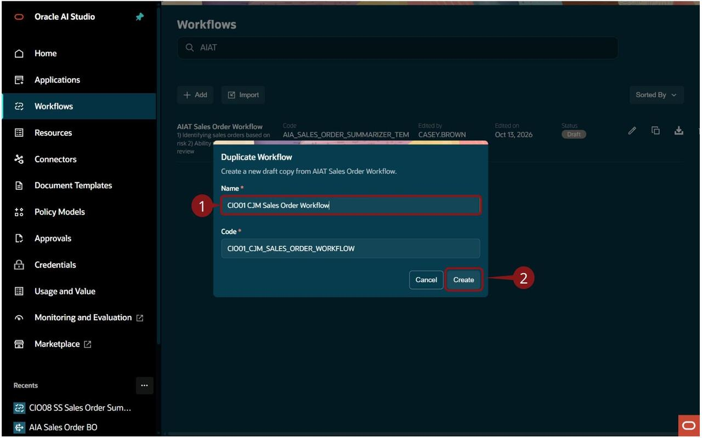

7. Here, you can see the pre-defined steps.  This shows a For Loop that loops through each sales order and identifies the Risk Level based on the defined Sales Order Risk Policy.

    > (1) Review the pre-defined **For Each Sales Order** node


    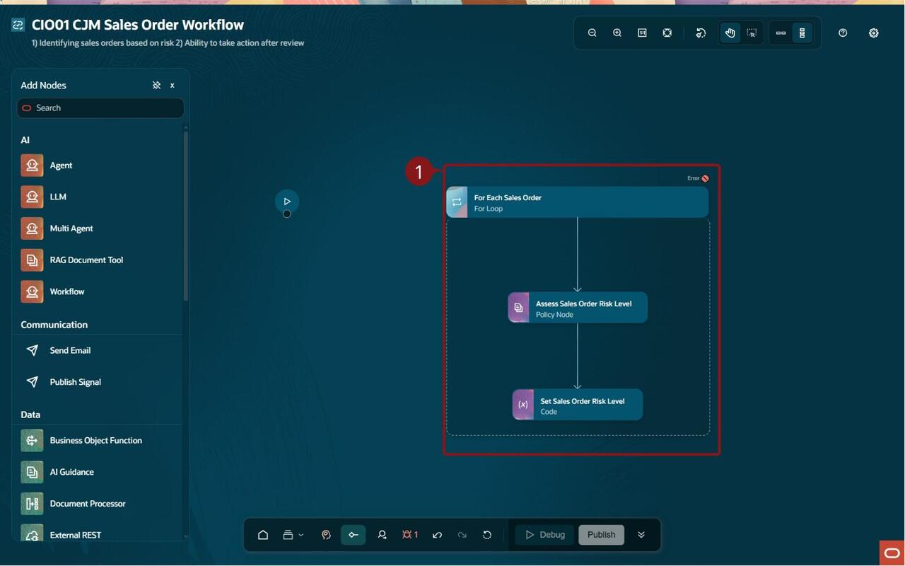

8. The first thing you want to do it create a Business Object node to access the Sales Orders.  You will do whiThis will enable the workflow to determine to appropriate route for this request.

    > (1) Click the  **Black Circle Icon** under the play icon and drag to empty space directly below it<br>
    > (2) Release the mouse once the drag is complete.

    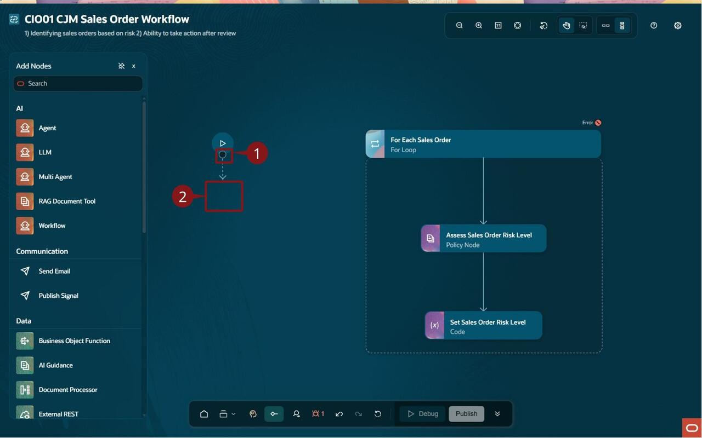

9. A dropdown list appears with a list of available nodes.  Pick Business Object Function from the resulting dropdown list or use the Search nodes…field

    > (1) Select  **Business Object Function** from the dropdown list


    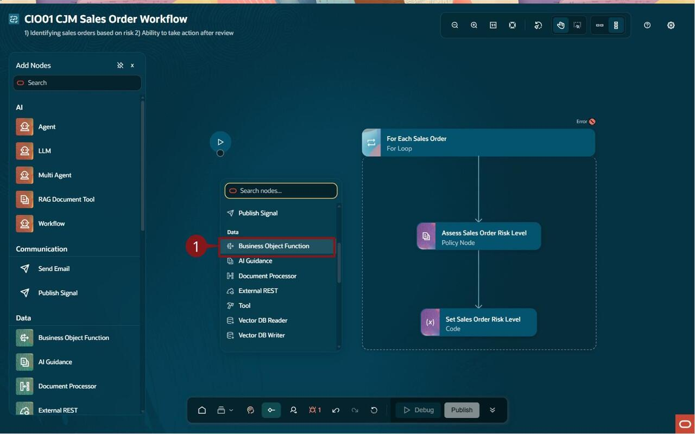

10. Now you can define your Business Ibject


    > (1) Enter **Get Sales Order** in the Name field <br>  

    > (2) Select Type **AIA** in the **Business Object** field and select **AIA Sales Order** from the Business Object dropdown <br>  

    > (3) Select **getSalesOrderBySubmittedDateRange** rom the **Function** dropdown.> (4) Scroll down.

    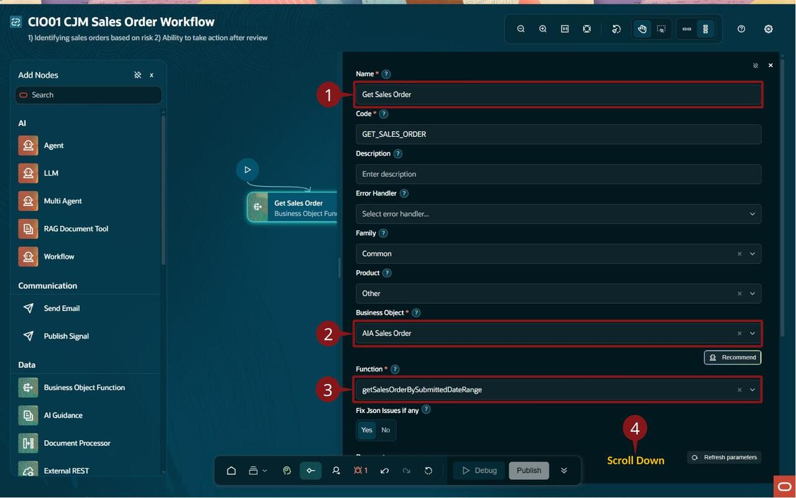

11. To keep things simple in this, you can enter the starting date for the Sales Order query.  This could be replaced with a user requested date range, but you’ll just enter a date.

    > (1) Enter **2026-10-01** in the salesOrderDateRange field (You can use any date, but pick one at least 30 days prior to today).<br>
    > (2) Click the **x** icon in the top right corner of the Business Object panel to close the panel. 


    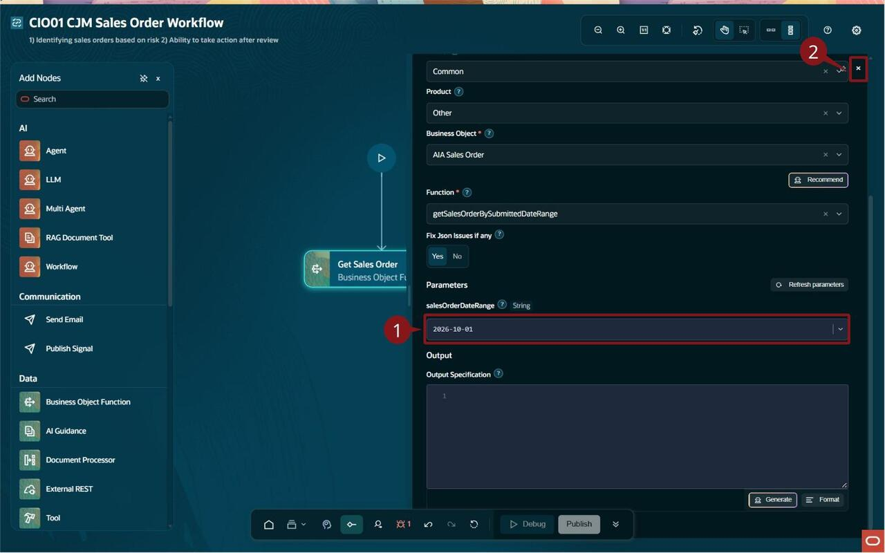

12. Next, you’ll add an LLM node.  This node will define the specific columns/fields from the Get Sales Order object that you’ll make available to the workflow.

    > (1) Hover over the **Get Sales Order** node, click the  **Black Circle Icon** that appears and drag to empty space directly below it<br>
    > (2) Release the mouse once the drag is complete.

    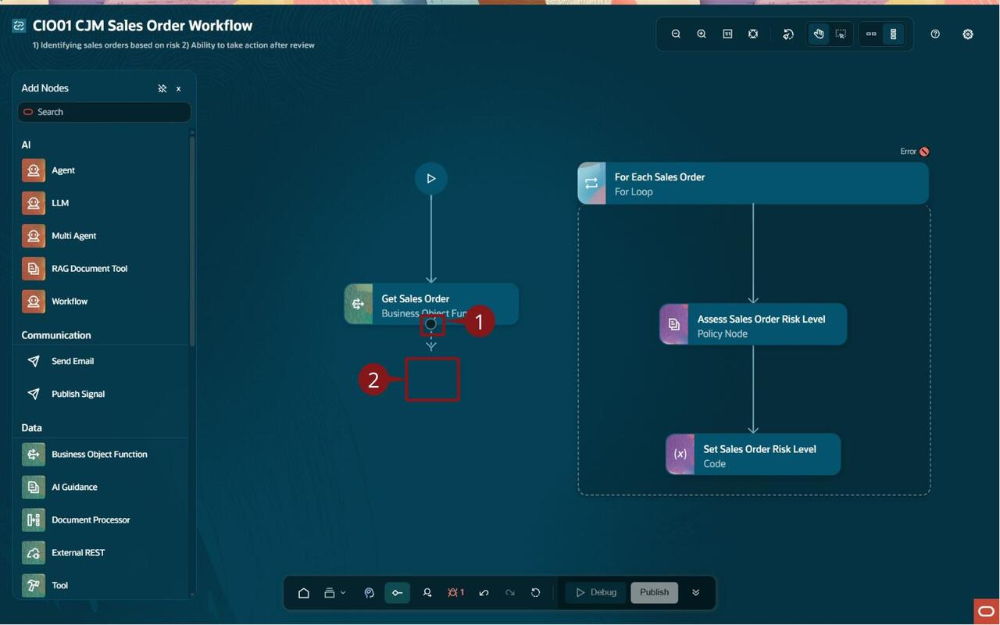

13. A dropdown list appears with a list of available nodes.  Pick LLM from the resulting dropdown list or use the Search nodes…field

    > (1) Select  **LLM** from the dropdown list


    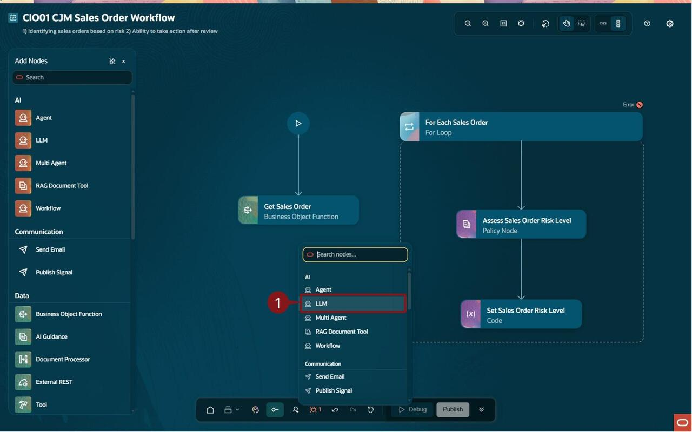

14. Enter the name of this LLM node.  Since this is used to determine the Sales Order fields available in this workflow, you can just call it Select Fields.

    > (1) Enter **Select Fields** in the Name field of the LLM Node properties panel.> (2) Scroll down.

    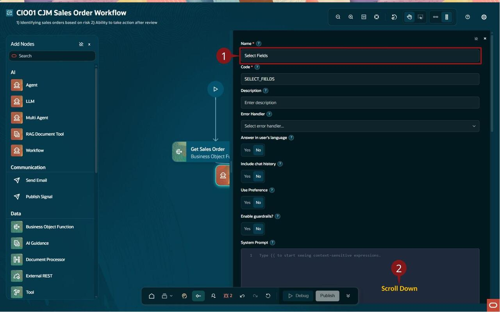

15. Here you’ll enter the prompt information and output specifiations for this node.  You want the workflow to determine whether the user is asking a query about benefit policies or trying to work with absences and leaves.

    > (1) Enter the **User Prompt**.  To streamline this step, we've pre-created the prompt. The prompt text is available in the ***copy block*** below or from the downloadable file provided in the pre-requisites for this lab.<br>
    > (2) Enter the **Output Specification**.  To streamline this step, we've pre-created the prompt. The prompt text is available in the ***copy block*** below or from the downloadable file provided in the pre-requisites for this lab.<br>
    > (3) Click the **x** icon in the top right corner to close the panel.  


    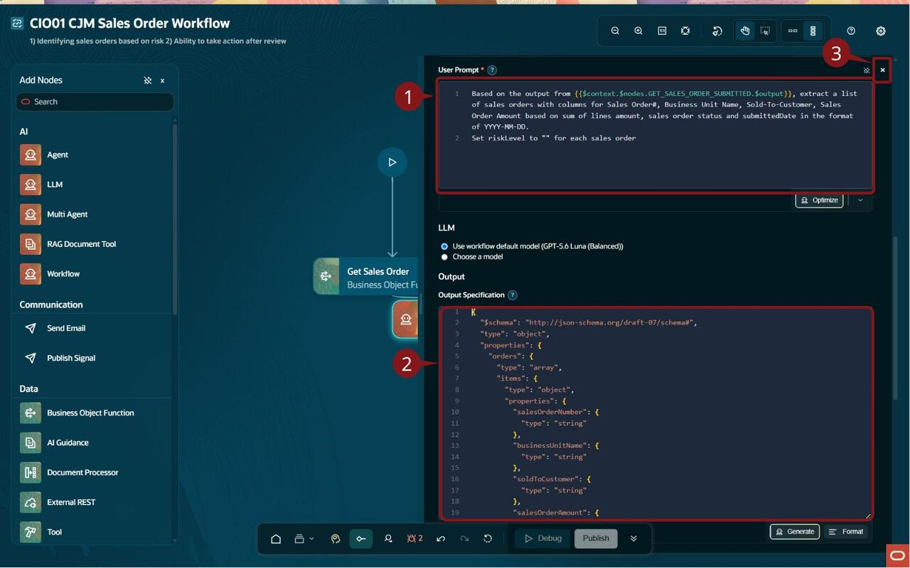

**User Prompt**:
```
<copy>
Based on the output from {{$context.$nodes.GET_SALES_ORDER_SUBMITTED.$output}}, extract a list of sales orders with columns for Sales Order#, Business Unit Name, Sold-To-Customer, Sales Order Amount based on sum of lines amount, sales order status and submittedDate in the format of YYYY-MM-DD. 

Set riskLevel to "" for each sales order
</copy>
```
**Output Specification**:
```
<copy>
{
  "$schema": "http://json-schema.org/draft-07/schema#",
  "type": "object",
  "properties": {
    "orders": {
      "type": "array",
      "items": {
        "type": "object",
        "properties": {
          "salesOrderNumber": {
            "type": "string"
          },
          "businessUnitName": {
            "type": "string"
          },
          "soldToCustomer": {
            "type": "string"
          },
          "salesOrderAmount": {
            "type": "string"
          },
          "orderStatus": {
            "type": "string"
          },
          "submittedDate": {
            "type": "string"
          },
          "riskLevel": {
            "type": "string"
          }
        },
        "required": [
          "salesOrderNumber",
          "businessUnitName",
          "soldToCustomer",
          "salesOrderAmount",
          "orderStatus",
          "submittedDate",
          "riskLevel"
        ],
        "additionalProperties": false
      }
    }
  },
  "required": [
    "orders"
  ],
  "additionalProperties": false
}
</copy>
```

16. Next, you’ll connect your Select Fields LLM node to the existing For Each Sales Order Node.  You can re-arrange your existing nodes via drag and drop or use the prettify icon at in the top toolbar to straighten up your nodes, as shown below.

    > (1) Optionally click the **Prettify** icon in the top toolbar to straighten your diagram.  You can also zoom in and out as desired.<br>
    > (2) Hover over the **Select Fields** node and drag to the top center of the **For Each Sales Order Node**.<br>
    > (3) When a **Black Circle Icon** appears at the top of the **For Each Sales Order** node you can release the mouse button and establish that connection. 

    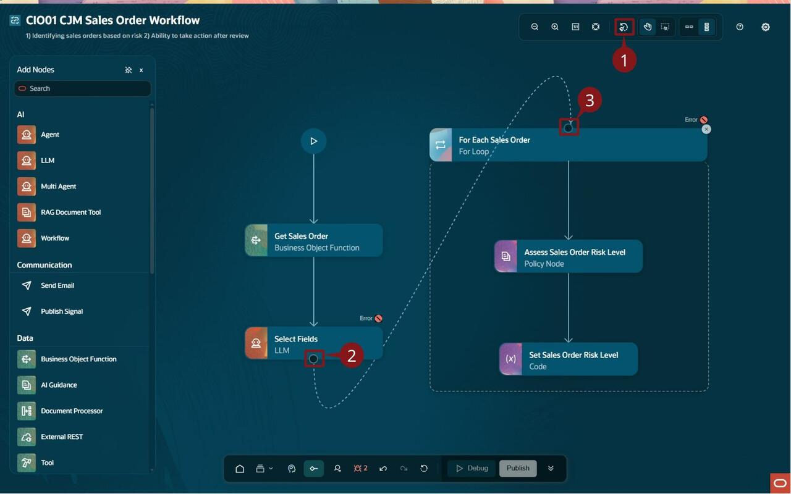

17. You have one final node to add and that is a node that will prepare and format the output from this workflow.  You’ll add this to the end of the For Each Sales Order node.

    > (1) Hover over the bottom of the **For Each Sales Order** node, click the  **Black Circle Icon** that appears and drag to empty space directly below it.<br>

    > (2) Release the mouse once the drag is complete.

    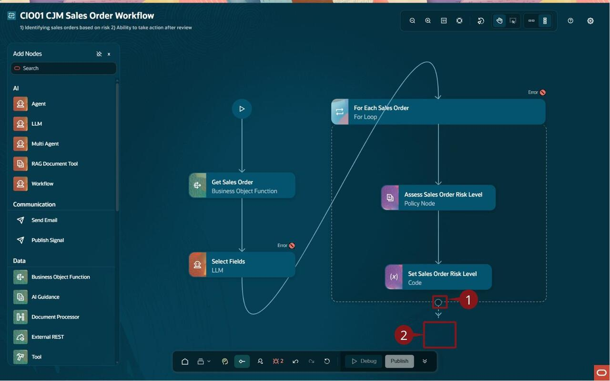

18. You have one final node to add and that is a node that will prepare and format the output from this workflow.  You’ll add this to the end of the For Each Sales Order node.

    > (1) Hover over the bottom of the **For Each Sales Order** node, click the  **Black Circle Icon** that appears and drag to empty space directly below it.<br>

    > (2) Release the mouse once the drag is complete.

    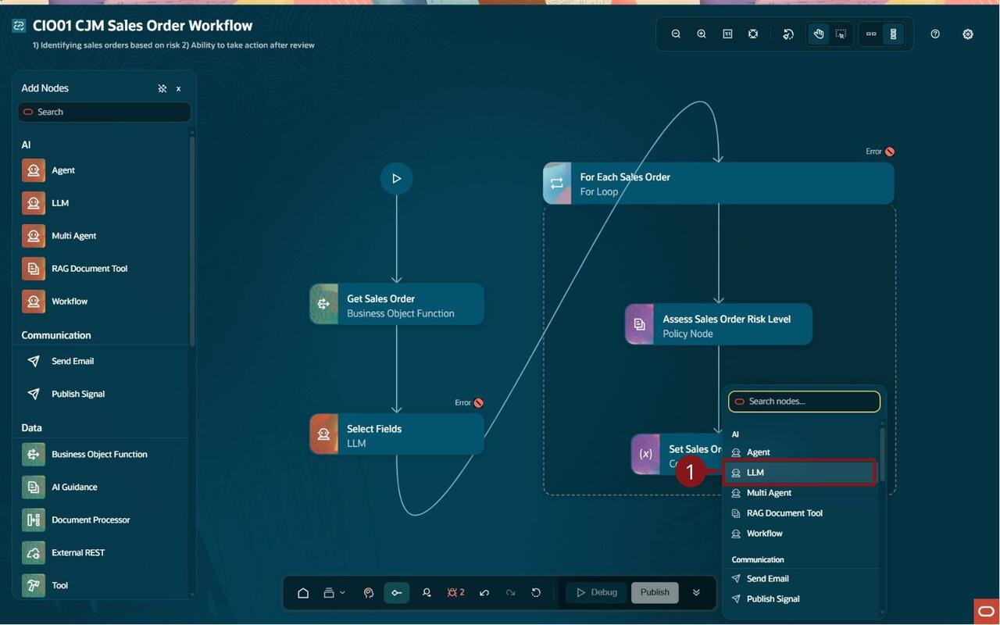

19. Enter the name of this LLM node, which will format and prepare the output of this workflow

    > (1) Enter **Prepare output** in the Name field of the LLM Node properties panel.<br>
    > (2) Scroll down.

    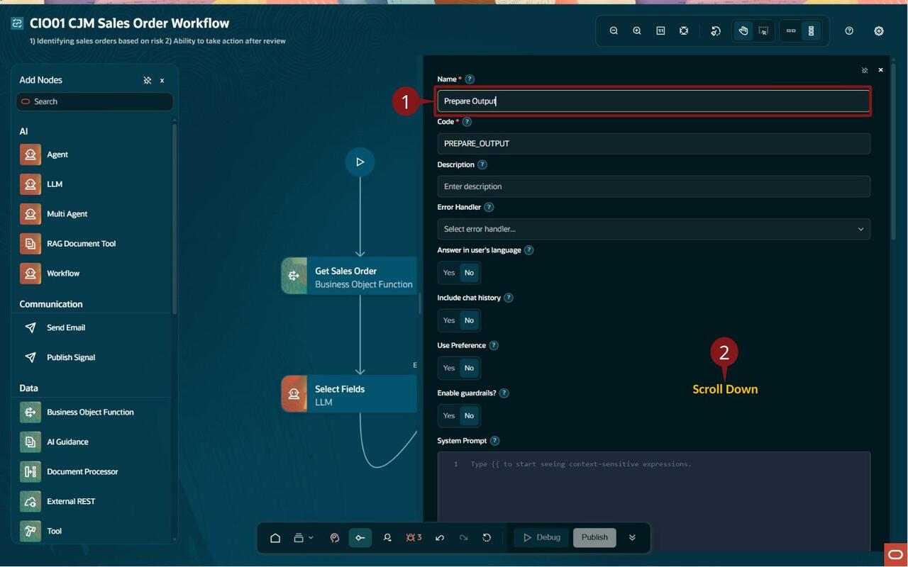

20. Here you’ll enter the prompt information for this node.  You want the workflow to output specific information for each sales order.

    > (1) Enter the **User Prompt**.  To streamline this step, we've pre-created the prompt. The prompt text is available in the ***copy block*** below or from the downloadable file provided in the pre-requisites for this lab.<br>> (2) Scroll down.


    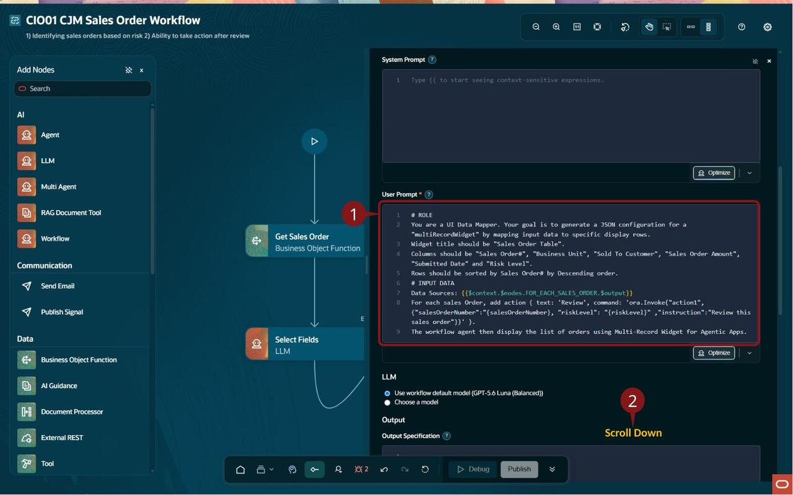

**User Prompt for Prepare Output node**:
```
<copy>
{
  "$schema": "http://json-schema.org/draft-07/schema#",
  "type": "object",
  "properties": {
    "orders": {
      "type": "array",
      "items": {
        "type": "object",
        "properties": {
          "salesOrderNumber": {
            "type": "string"
          },
          "businessUnitName": {
            "type": "string"
          },
          "soldToCustomer": {
            "type": "string"
          },
          "salesOrderAmount": {
            "type": "string"
          },
          "orderStatus": {
            "type": "string"
          },
          "submittedDate": {
            "type": "string"
          },
          "riskLevel": {
            "type": "string"
          }
        },
        "required": [
          "salesOrderNumber",
          "businessUnitName",
          "soldToCustomer",
          "salesOrderAmount",
          "orderStatus",
          "submittedDate",
          "riskLevel"
        ],
        "additionalProperties": false
      }
    }
  },
  "required": [
    "orders"
  ],
  "additionalProperties": false
}
</copy>
```

21. You can enable various capabilities for how this workflow interacts with a resulting Agentic App.

    > (1) Click the **On** option for the **Enable Actions for the widgets** options under **App Experience**Enter the **User Prompt**.  To streamline this step, we've pre-created the prompt. The prompt text is available in the copy block below or from the downloadable file provided in the pre-requisites for this lab.<br>> (2) Click the **x** icon in the top right corner of the Business Object panel to close the panel. 

    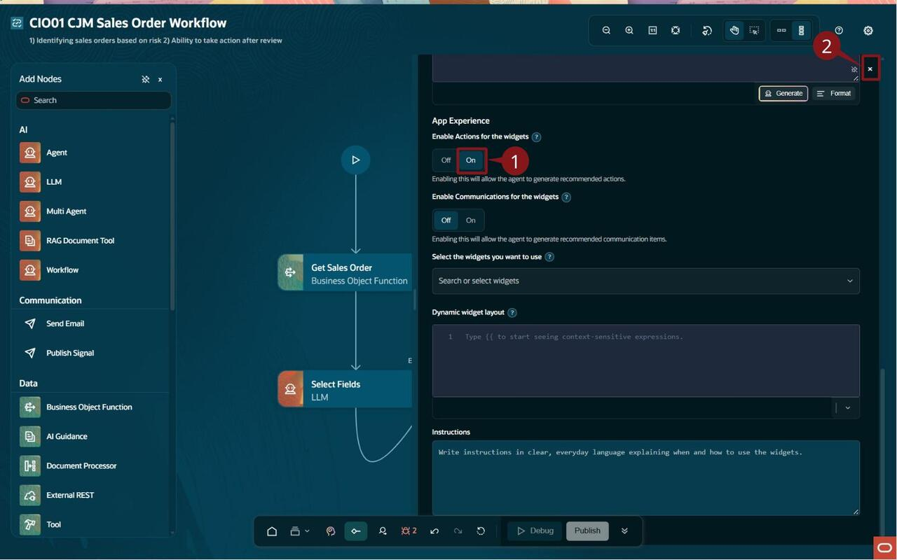

22. Congratulations, you’ve completed your workflow configuration.  You won’t test here as you’ll save the testing until after you’ve used this workflow in an Agentic App.  You do need to Publish this workflow, though, to make it available to the Agentic App.

    > (1) Confirm that there are no bugs/errors showing on the bottom toolbar and then click the **Publish** button.

    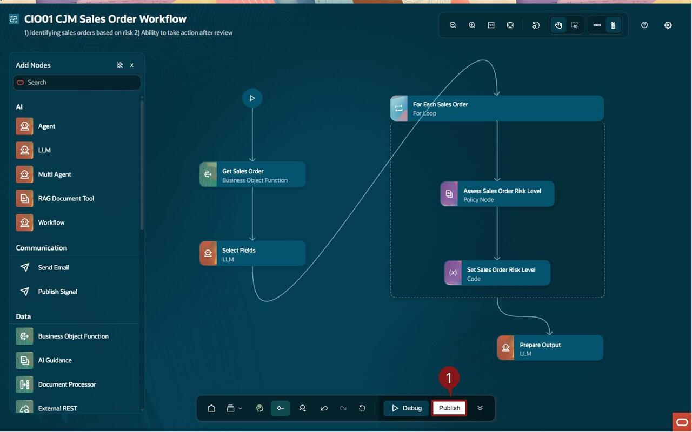


26. Congratulations!  

    > **You've completed this Adventure**. Please close this tab.

### Summary

AI Agent Studio is a design-time environment that empowers you to create, configure, validate, and deploy AI agents to meet your organization's needs.

With AI Agent Studio, you can easily extend preconfigured workflows, and build new workflows and agentic apps. AI Agent Studio is fully integrated into Oracle Fusion Cloud Applications, providing secure and seamless access to the knowledge stores, tools, and APIs of Fusion Applications. This integration enables agents to be deployed directly into the flow, ensuring an efficient process.

## Learn More

* [AI Agent Studio](https://docs.oracle.com/en/cloud/saas/fusion-ai/26d/aiaas/overview-of-ai-agent-studio.html)
* [AI Agents for Fusion Applications](https://www.oracle.com/applications/fusion-ai/ai-agents/)
* [AI for Fusion Applications](https://www.oracle.com/applications/fusion-ai/)
* [Oracle Documentation](http://docs.oracle.com)

## Acknowledgements

* **Author** - Stephen Chung, Principal SaaS Cloud Technologist; Sajid Saleem, Master Principal SaaS Cloud Technologist; Charlie Moff, Distinguished SaaS Cloud Technologist
* **Contributors** - The AI Adventure Team (Gus, Sajid, Casey, Stephen, Sohel, Xavier, Charlie, Ray)
* **Last Updated By/Date** - Sajid Saleem/Charlie Moff, October 2026
