# Create an Agentic App for Procurement using existing Workflow Agents and App specific configurations

## Introduction

AI Agent Studio for Fusion Applications is a comprehensive platform for creating, extending, deploying and managing AI Agents and Agent Teams across the enterprise. Oracle AI Agent Studio delivers easy-to-use tools, including advanced testing, robust validation, and built-in security, that helps Oracle Fusion Applications customers and partners create and manage AI agents. Leveraging the same technology that Oracle uses to create AI agents, Oracle AI Agent Studio enables users to easily extend pre-packaged agents and/or create new agents and then deploy and manage them.

### Objectives

In this activity you will use Oracle Fusion AI Agent Studio to
* Create an Agentic Application
* Define Agentic App sections to display various output formats (eg. graphics)
* Create Drilldown Action

Estimated Time: 10-15 minutes

## Begin Exercise

1. Create Agentic App including Actions and Testing

    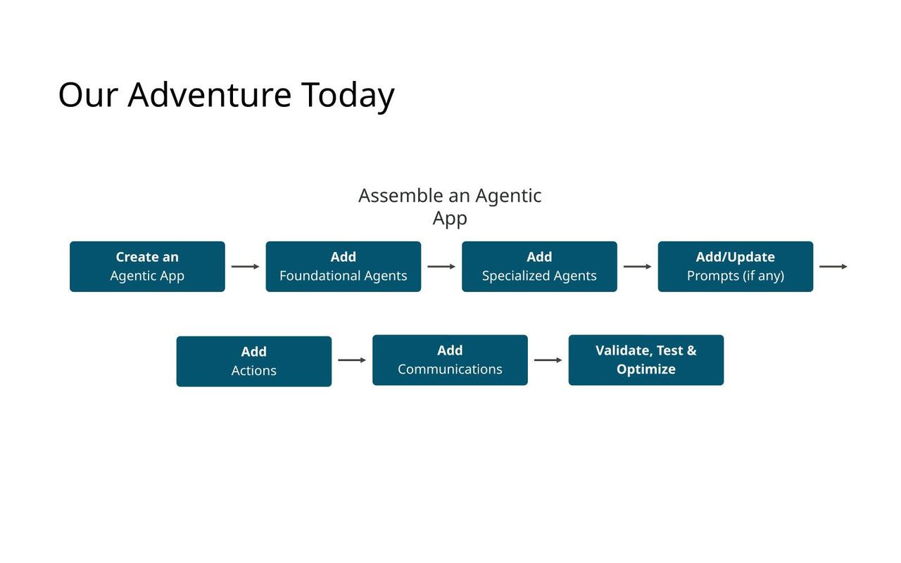

2. Open AI Agent Studio

    > (1) Click the **Tools** menu tab 

    > (2) Click the **AI Agent Studio** tile

    

3. Expand Menu

    > (1) Hover your mouse over the **Oracle** Icon.  

    > (2) Click on the **Pin** Icon to expand the menu. > (3) Click on the **Applications** Icon.

    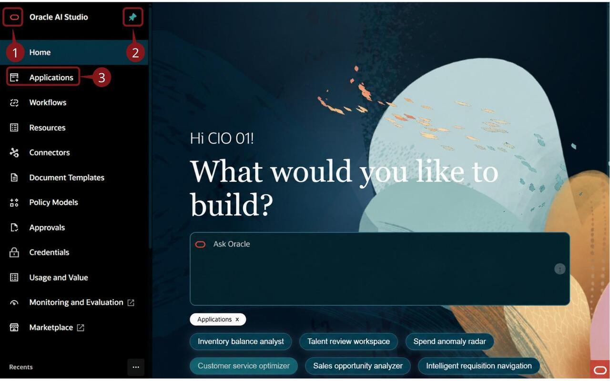

4. Create a New Agentic Application

    > (1) Click on the **Add** Icon.

    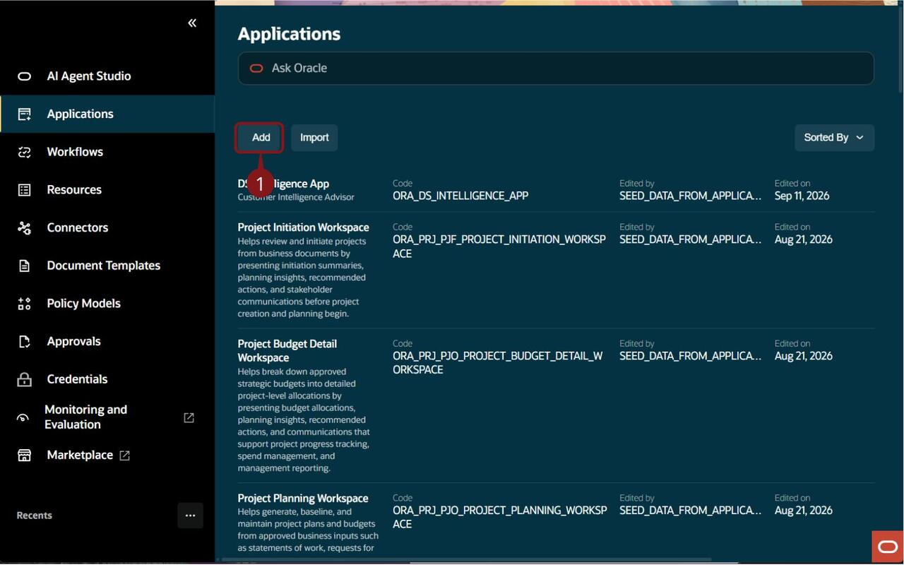

5. Create a name and add a description to your agentic app.

    > (1) Enter **CIO XX YYY Sales Order Workspace** as a name.  **XX** is your assigned account for this lab and **YYY*** is your initials.  Copy and paste the name into description.  

    > (2) Click on **Create**.Slide Name: Application Name

    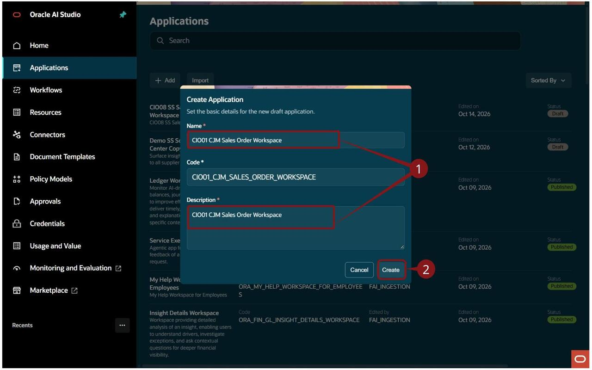

6. On the App Settings panel on the right side, you can see a variety of options and capabilities that you can enable for this Agentic App.  For now, you’ll just scroll to the botton of the App Settings window to see additional options.

    > (1) Scroll down to the bottom of the App Settings panel on the right

    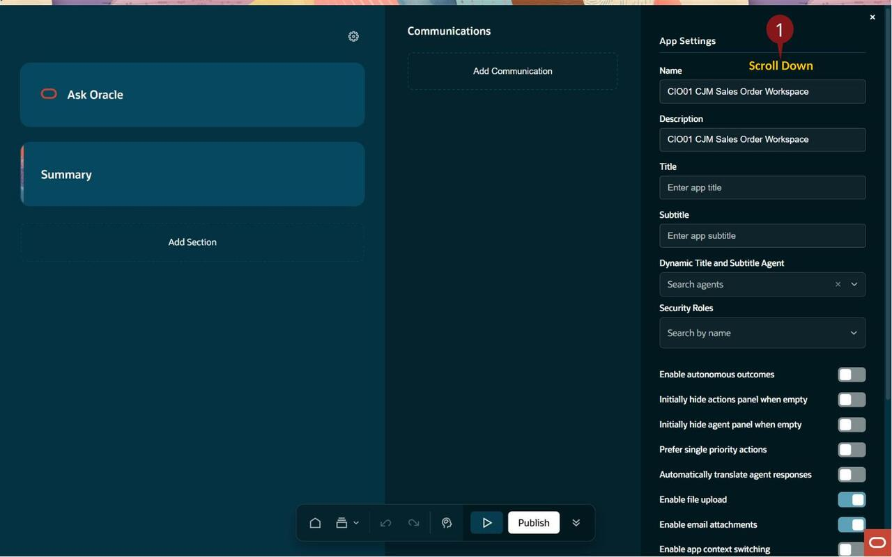

7. At the very bottom of the App Settings panel, the Page Options section shows various layout options.

    > (1) Select the 2nd icon that depicts two equal sized columns.Slide Name:  Select Two Columns

    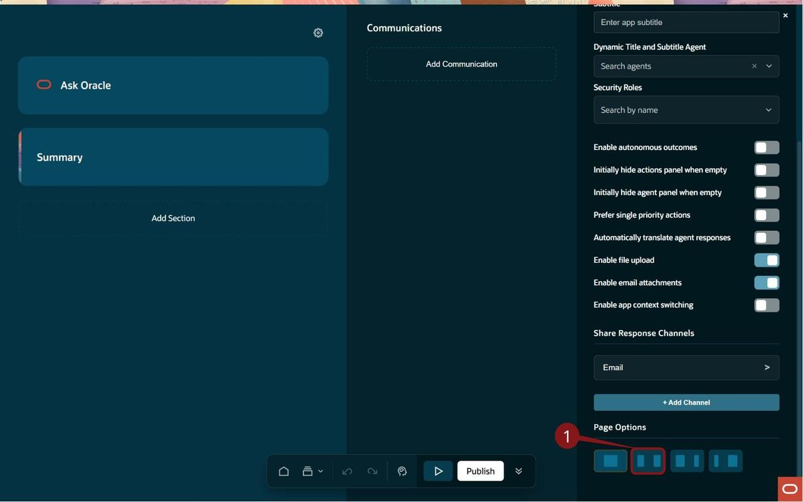

8. You’ll now see 2 Add Section columns.   This is where you will add content.

    > (1) Click the **Add Section** box on the left, enter **CIOXX YYY** in the **Search by agent name** field, and select **CIO XX YYY Sales Order Workflow** from the resulting dropdown box.  Remember, XX is user assigned user number and YYY are your initials.

    > (2) Name this Section by entering **Sales Orders** into the Name field in the App Settings panel.

    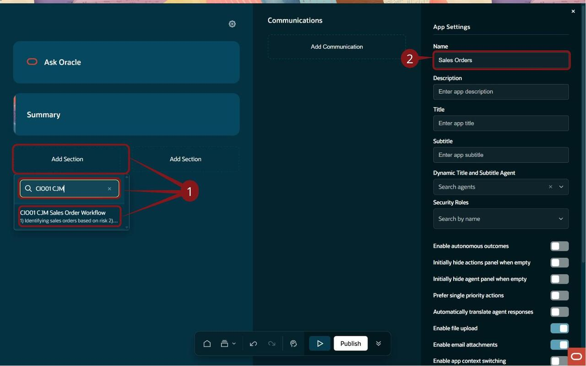

9. Next, you’ll add a Section on the right.

    > (1) Click the **Add Section** box on the right, enter **AIA** in the **Search by agent name** field, and select **AIA Sales Order Risk Evaluation** from the resulting dropdown box.  

    > (2) Name this Section by entering **Review Sales Orders** into the Name field in the App Settings panel.> (3) Click the **Play** icon on the bottom toolbar to see how your Agentic App looks so far.

    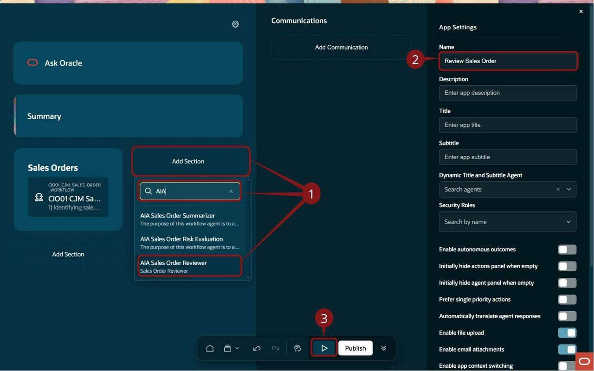

10. Review the various capabilities of the Agentic App and then prepare to add some additional capabilities.

    > (1) Note some key features of your application.  An **Ask Oracle** field for interacting with your application, summary of important page content, and detailed Sales Order transaction information.> (2) Click the **Edit** button on the bottom toolbar to put the Agentic App back into Edit mode.Slide Name:  Review and edit

    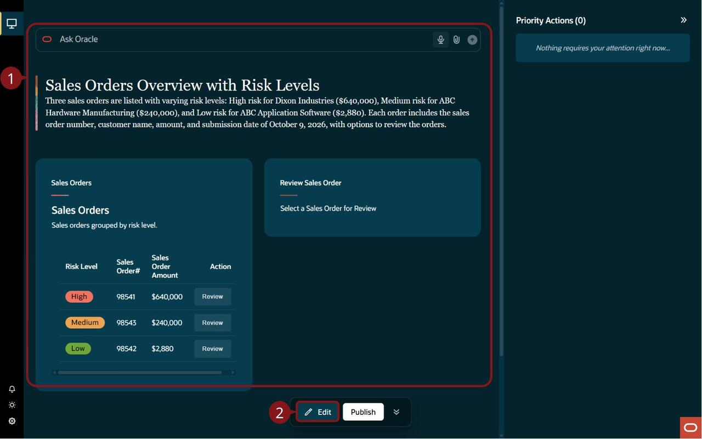

11. You can add additional capabilities like like Actions and Communications (e.g. Powerpoint, Word, PDF, Email, Text and Podcasts).    You’ll setup a new Action.

    > (1) Click on the **Agentic App** definition icon on the bottom toolbar (2nd icon from the left).

    > (2) The resulting menu allows you to add additional capabilities.  You want to add a **Action**, so click the **+** icon to the right of **Actions**

    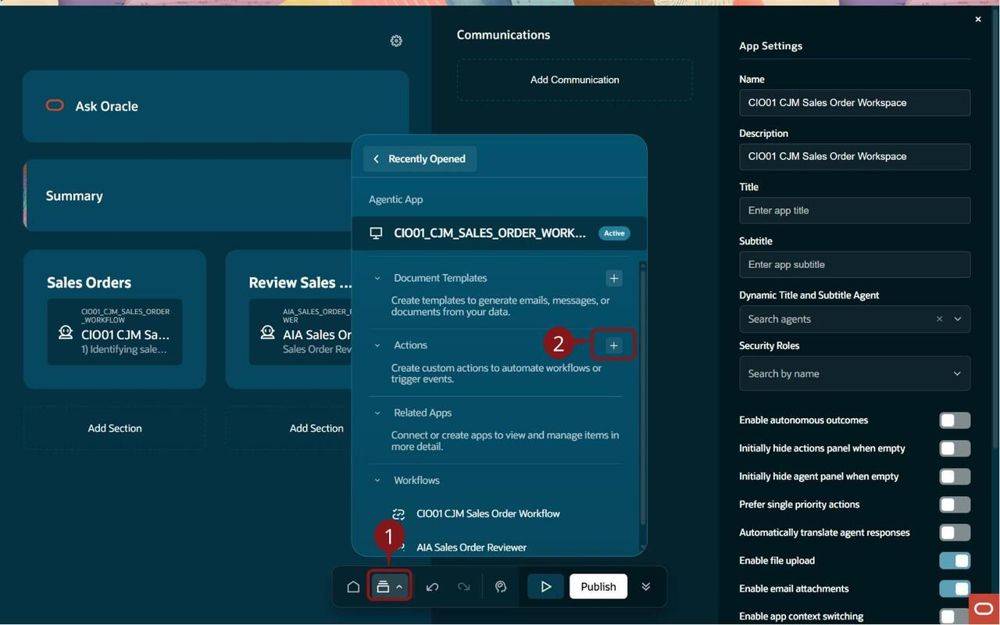

12. You can add additional capabilities like Actions and Communications (e.g. Powerpoint, Word, PDF, Email, Text and Podcasts).    You’ll setup a new Action.

    > (1) Click in the **Add Step** box and select **Switch App Context** from the resulting dropdown. Slide Name:  Add Action Step

    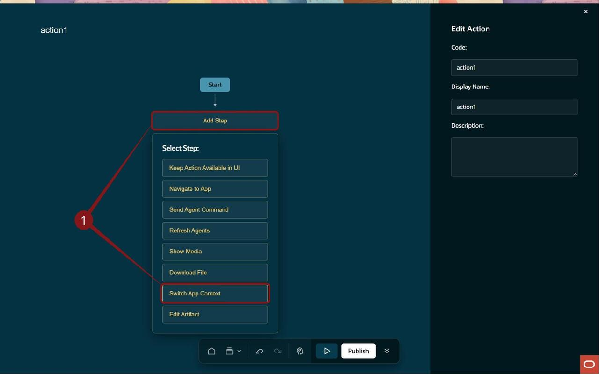

13. You want to allow this Action Step to leverage the Agent Payload as Context for this action.

    > (1) Click in the **Checkbox** box next to **Use Payload as Context**

    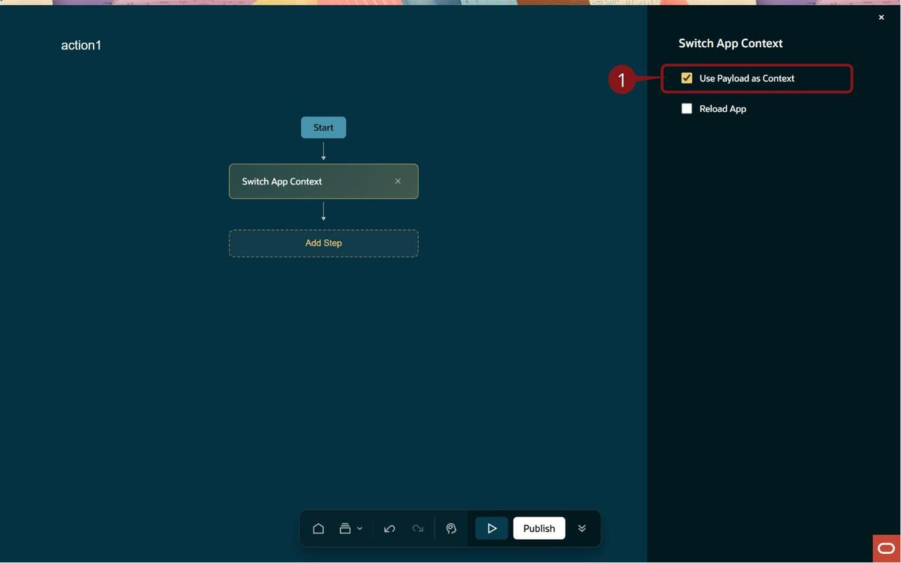

14. You want one more step for your Action.  You want the Agents to refresh.

    > (1) Click in the **Add Step** box and select **Refresh** from the resulting dropdown. 

    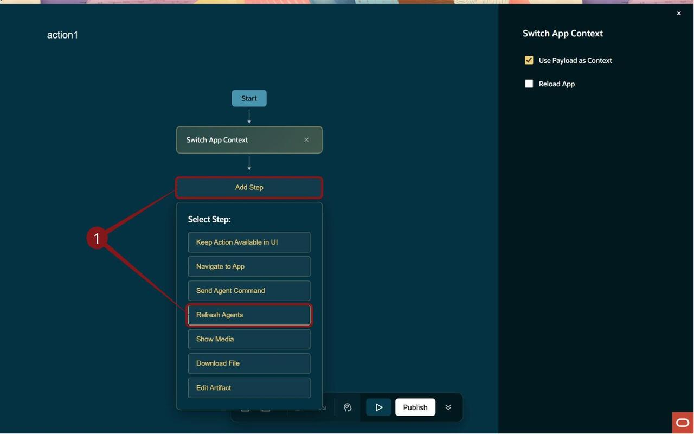

15. You can specify which or your included Agents you want to refresh.

    > (1) Click in the **Select refresh targets** and select **AIA Sales Order Risk Evaluation** from the dropdown.

    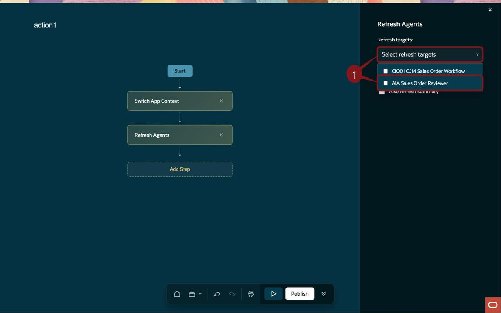

16. Agentic Apps can have priority actions, so you’ll want those actions to automatically refresh when this action is executed..

    > (1) Click in the **Checkbox** box next to **Allow refresh priority actions**

    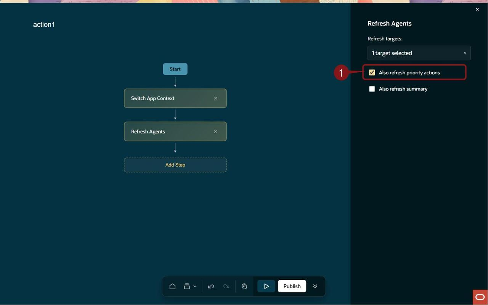

17. Ready to test.

    > (1) Click the **Play** icon on the bottom toolbar to see how your Agentic App looks so far.

    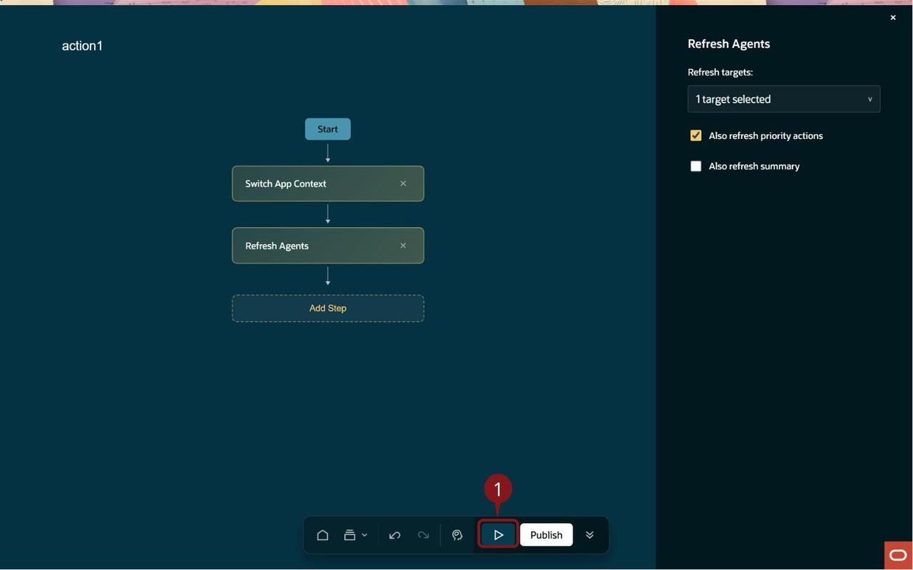

18. Review your Agentic App.

    > (1) Note that the Agentic App provides a summary of your Sales Order Risk Levels 

    > (2) You want to review the Risk associated to the order with the **High** risk level.  Click the **Review** button next to the order with a High Risk Level.

    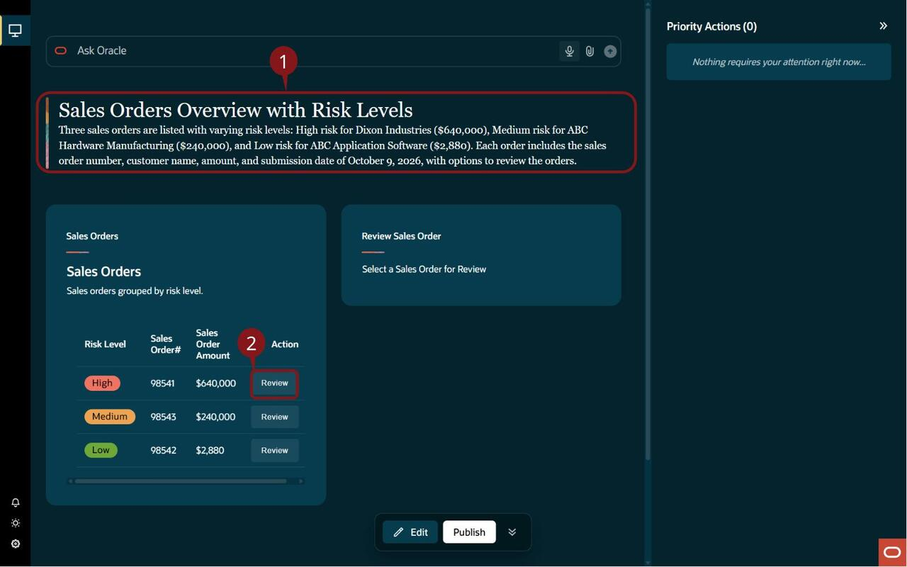

19. Review High Risk Order.

    > (1) Review response related to this Risk order.

    > (2) To send notifications related to this order, click the **High Risk Order Notification** button.

    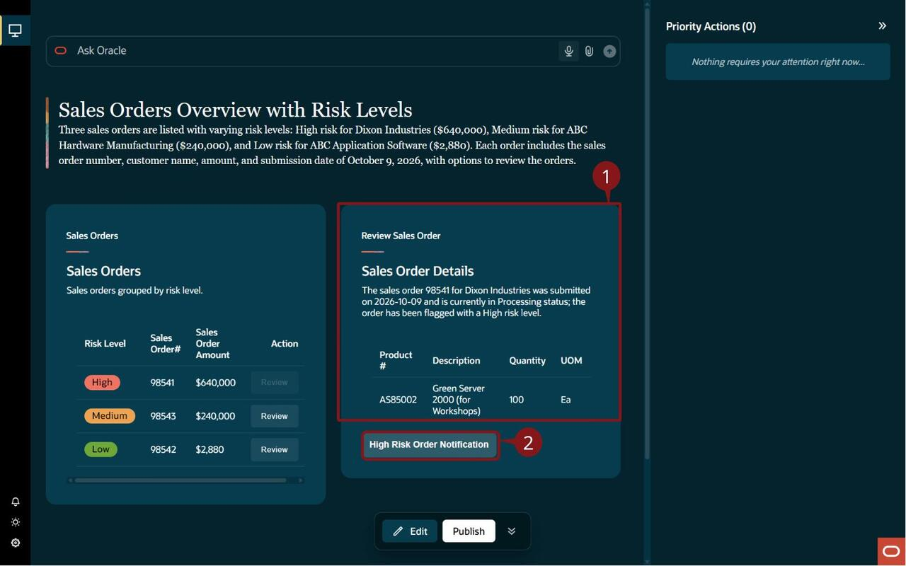

20. Review Notification.

    > (1) Review the prepared notificationSlide Name:  Notification

    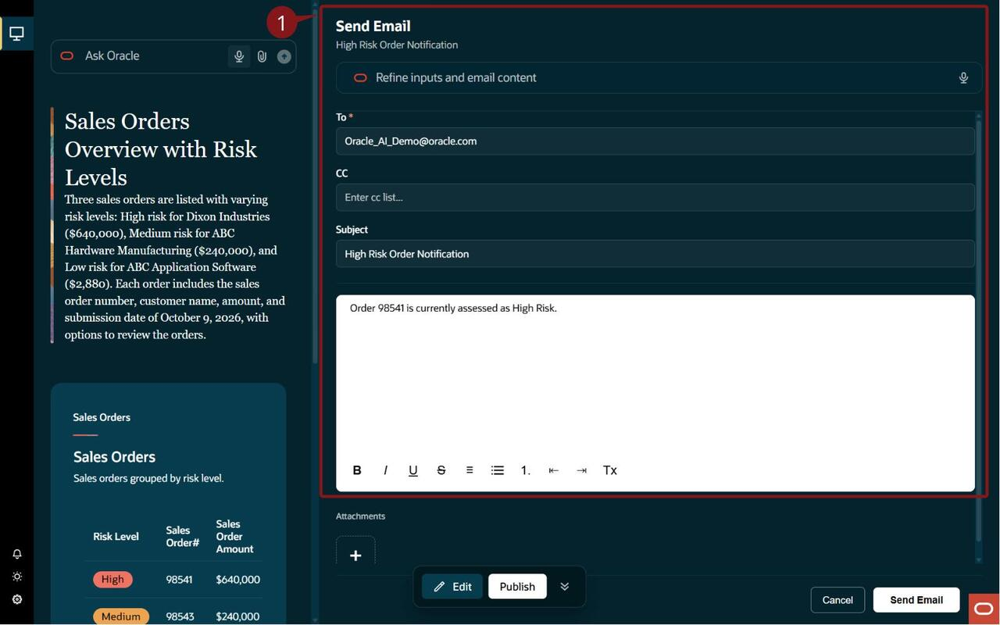

26. Congratulations!  

    > **You've completed this Adventure**. Please close this tab.

### Summary

AI Agent Studio is a design-time environment that empowers you to create, configure, validate, and deploy AI agents to meet your organization's needs.

With AI Agent Studio, you can easily extend preconfigured workflows, and build new workflows and agentic apps. AI Agent Studio is fully integrated into Oracle Fusion Cloud Applications, providing secure and seamless access to the knowledge stores, tools, and APIs of Fusion Applications. This integration enables agents to be deployed directly into the flow, ensuring an efficient process.

## Learn More

* [AI Agent Studio](https://docs.oracle.com/en/cloud/saas/fusion-ai/26d/aiaas/overview-of-ai-agent-studio.html)
* [AI Agents for Fusion Applications](https://www.oracle.com/applications/fusion-ai/ai-agents/)
* [AI for Fusion Applications](https://www.oracle.com/applications/fusion-ai/)
* [Oracle Documentation](http://docs.oracle.com)

## Acknowledgements

* **Author** - Stephen Chung, Principal SaaS Cloud Technologist; Sajid Saleem, Master Principal SaaS Cloud Technologist; Charlie Moff, Distinguished SaaS Cloud Technologist
* **Contributors** - The AI Adventure Team (Gus, Sajid, Casey, Stephen, Sohel, Xavier, Charlie, Ray)
* **Last Updated By/Date** - Sajid Saleem/Charlie Moff, October 2026