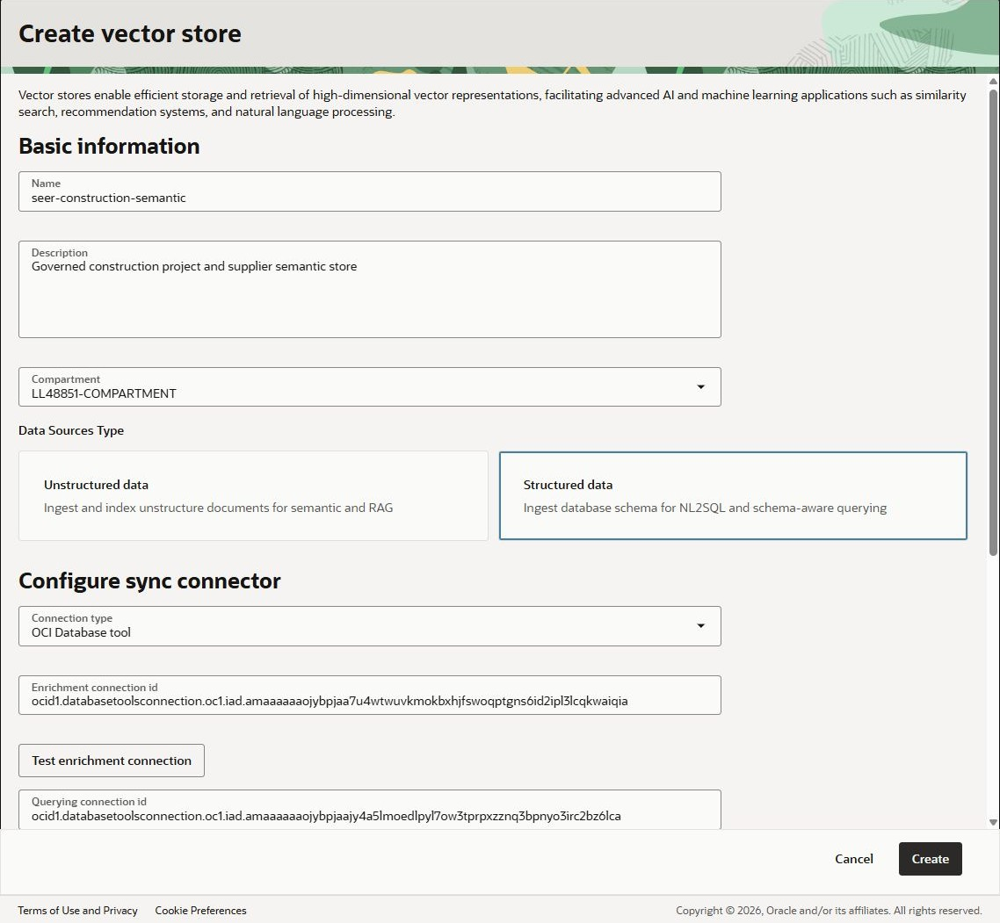
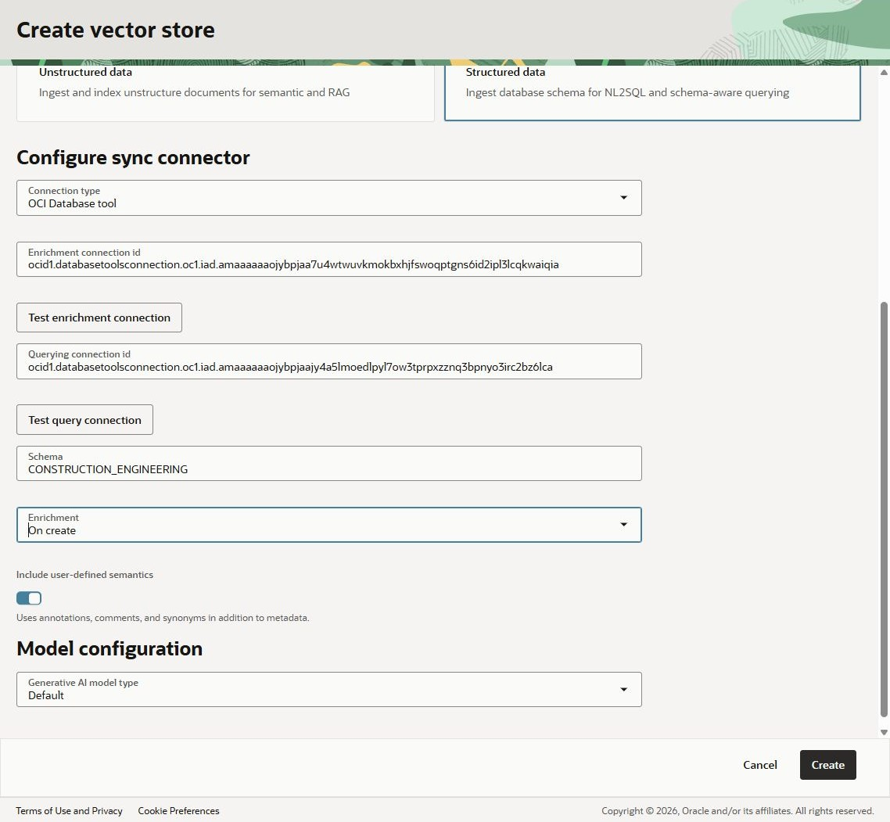
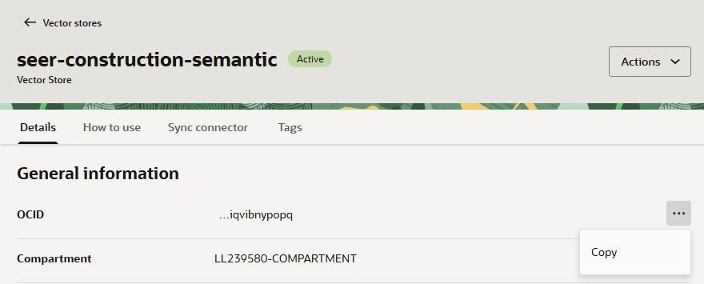
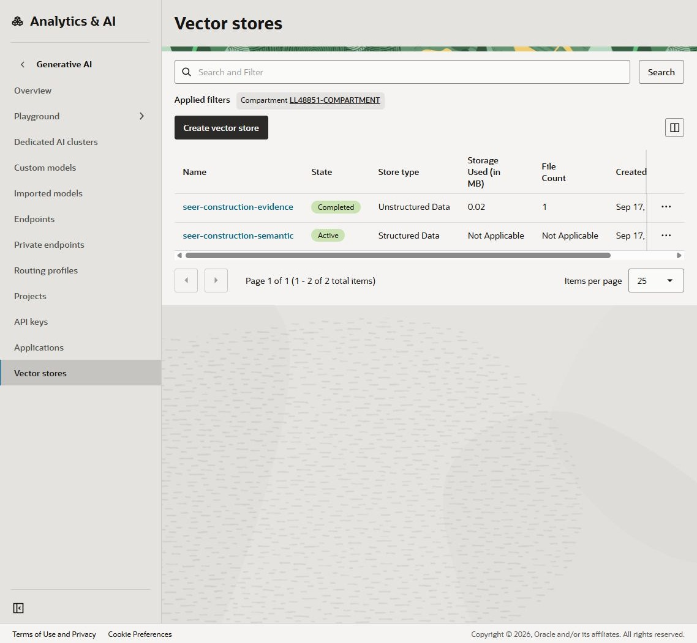

# Lab 2: Semantic Store

## Introduction

In this lab, you create the structured semantic store for construction project, supplier, inspection, schedule, and compliance questions. The environment already includes the Autonomous AI Database, Construction Engineering schema, seed data, Vault secret, and Database Tools connections. The sample app sends natural-language questions to NL2SQL, validates the generated SQL, and retrieves governed Gold-view data through the ADB MCP Server.

Estimated Time: 10 minutes

### Objectives

In this lab, you will:

- Create a structured semantic store
- Connect the semantic store to the pre-created construction intelligence database
- Run the semantic enrichment
- Record the semantic store OCID for the sample app

### Prerequisites

This lab assumes you have:

- Completed the Unstructured RAG lab

## Task 1: Create the structured semantic store

1. In the Console navigation menu, go to **Analytics & AI**, then **Generative AI**.

1. Select **Vector stores**.

    > **Console navigation:** If **Vector stores** is not visible on the Generative AI overview, select **Applications** and expand the left navigation to find it.

1. Select the reservation-specific child compartment from your sandbox resource list.

1. Click **Create vector store**.

1. Enter the following values:

    ```text
    Name: seer-construction-semantic
    Description: Governed construction project and supplier semantic store
    Compartment: <workshop-compartment>
    Data source type: Structured data
    Connection type: OCI Database tool
    ```

    

    Use the **Database Tools Enrichment connection OCID** and **Database Tools Query connection OCID** from your Sandbox Resource List (LiveLabs may shorten these labels to **DB Tools Enrichment Connection OCID** and **DB Tools Query Connection OCID**). Use the same workshop region as Lab 1.

    ```text
    Enrichment connection ID: <DB Tools Enrichment Connection OCID>
    Querying connection ID: <DB Tools Query Connection OCID>
    Schema: CONSTRUCTION_ENGINEERING
    Enrichment: On create
    ```

1. Click **Test enrichment connection** to make sure the semantic store can use the connection to connect to the database.

1. Click **Test query connection** to make sure the semantic store can use the connection to connect to the database.

    

1. Click **Create**.

1. Wait for `seer-construction-semantic` to reach **Active** and confirm that semantic enrichment completed successfully. Do not continue while enrichment is queued, running, or failed.

1. Click **seer-construction-semantic** in the vector stores list to open its details. Find **OCID**, click **Copy**, and record the complete value as `Structured semantic store OCID` (`OCI_GENAI_SEMANTIC_STORE_OCID` in the worksheet). This identifier starts with `ocid1.generativeaisemanticstore`; do not copy the unstructured store's `vs_` identifier or a Database Tools connection OCID.

    If the value is abbreviated, open the **...** action menu at the right of the **OCID** row and select **Copy** to copy the full identifier.

    

At this stage, the semantic store has enriched metadata for generating SQL against the governed construction Gold views. In the sample application, NL2SQL generates SQL, the application validates its project scope, and ADB MCP Server executes it. Creating the store has not yet tested that complete application path.

The list should now include both `seer-construction-evidence` from Lab 1 and `seer-construction-semantic` from this lab. Screenshot compartments and OCIDs are examples; continue using your own reservation's identifiers.



Choose **Lab 3A: Build the Sample Application** to run and modify Python locally, or **Lab 3B: Launch the Sample Application** to deploy the pre-built container. Complete only one path, then continue to Lab 4.

## Learn More

- [OCI Generative AI QuickStart for semantic stores and NL2SQL](https://docs.oracle.com/en-us/iaas/Content/generative-ai/get-started-agents.htm)

## Acknowledgements

- **Author** — Julien Lehmann - Product Marketing Manager, Yanir Shahak - Senior Principal Software Engineer
- **Contributors** — Oracle LiveLabs Platform Team
- **Last Updated By/Date** — Eli Schilling, November 2026
