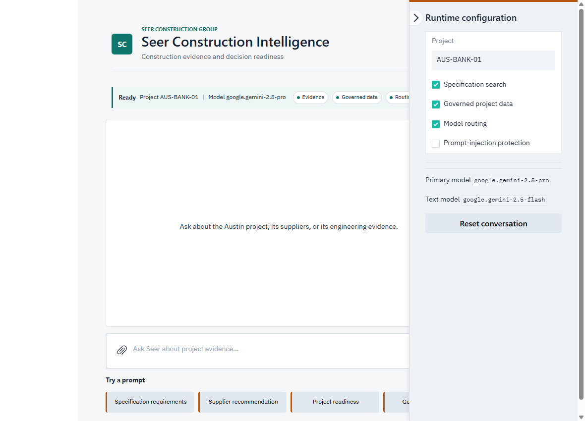
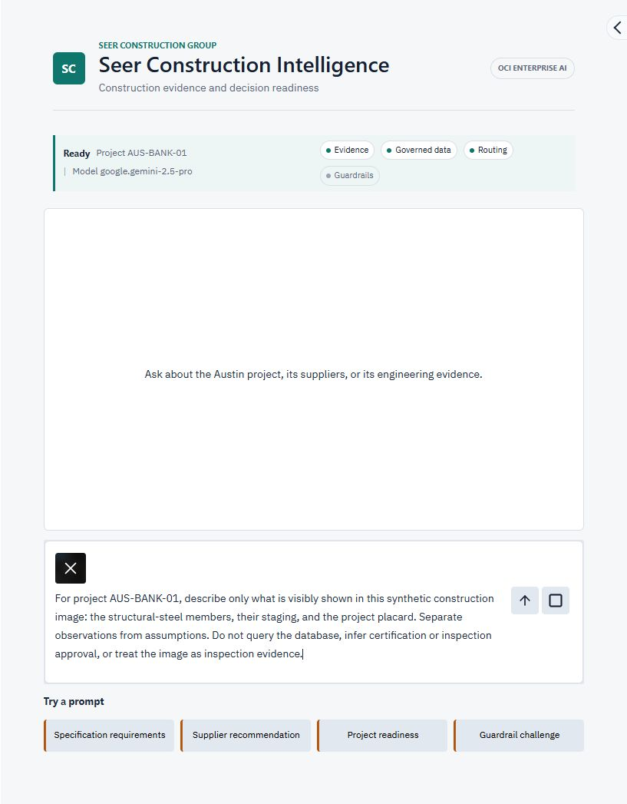

# Lab 4: Model Optimization

## Introduction

In this lab, you enable model routing in Seer Construction Intelligence. Build-path participants implement the routing decision in Python; Launch-path participants enable the equivalent capability in the running application. Text-only questions use the lower-cost model, while image prompts remain on the stronger multimodal model.

Estimated Time: 15 minutes

### Objectives

- Establish a single-model baseline
- Implement or configure a text-versus-image routing decision
- Compare text and image workloads
- Optionally evaluate another model

### Prerequisites

- A running application from Lab 3A or Lab 3B
- Access to both configured models in the workshop region

Follow only the subsection for your chosen application path in Task 2. **Launch (Lab 3B)** uses the running application's configuration panel and requires no Python file edits or completion of Lab 3A. **Build (Lab 3A)** uses your downloaded local sample-app folder and code editor.

## Task 1: Record the baseline

The **baseline** is the application before routing: both the text question and the image question use the primary model. You will repeat these two requests with routing enabled and check whether the model changes appropriately while the answers remain useful. This is a model-selection and answer-quality exercise, not a formal speed benchmark or a measured cost-saving claim.

For Launch, **Primary model** and **Text model** in Runtime configuration identify the configured candidates, not two models running simultaneously. With routing off, every request uses the primary model (normally `google.gemini-2.5-pro`). With routing on, text-only requests use the text model (normally `google.gemini-2.5-flash`), while images stay on the primary model. The **Model** value in the runtime bar identifies the model selected for the submitted request; record it after submitting, rather than treating the configuration labels as the result. Build participants can also check the terminal's model log.

After each completed request, the metrics strip below the conversation shows **Selected model**, **App response time**, **Input tokens**, **Output tokens**, and **Responses API calls**. Record these values for each comparison. App response time covers server-side handling, including guardrail checks, conversation setup, retrieval, tool follow-ups, and answer delivery by the app. It excludes file upload, browser/network transit to the app, and queue wait before the handler starts; it is not model-only latency.

Token counts sum the usage returned by the Responses API across the initial call and all SQL-tool follow-up calls for that submission. They are not a conversation total and do not count separate NL2SQL/guardrail service usage or hidden service-internal calls. The call counter counts application-level Responses API invocations, not SDK transport retries. **Unavailable** means usage was missing or incomplete, not zero usage. A blocked prompt can show zero Responses API calls; that does not mean guardrail processing was free. Metrics clear on reset and update for the next request.

If you are using an older app without the metrics strip, use a stopwatch from submission until the complete answer and **Ready** status, and label this **manual end-to-end time**. Do not compare manual timing directly with app timing. Enter **Not measured** when necessary; the model and answer checks remain sufficient to complete the lab.

1. For **Launch**, open **Runtime configuration** on the right side of the application. Enable **Specification search** and **Governed project data**, and leave **Model routing** and **Prompt-injection protection** disabled. Close the panel and confirm that the runtime bar shows **Routing** disabled. For **Build**, both retrieval paths are enabled in the starter; confirm that `.env` retains `OCI_GENAI_MODEL_ROUTING_ENABLED=false` and `OCI_GENAI_PROMPT_PROTECTION_ENABLED=false`. Restart the local app if you changed these values. Build has no Runtime configuration menu.

2. Start a fresh conversation with **Reset conversation**. Select **Supplier recommendation**, submit the prompt, and record the selected model, app response time, input/output tokens, and Responses API call count from the metrics strip. Keep this answer for comparison in Task 3.

3. Download the [synthetic structural-steel delivery image][synthetic-steel-image], or reuse the PNG from Lab 3A Task 9. Start a fresh conversation (**Reset conversation**), use the paperclip in the prompt composer to attach the downloaded image, and submit the following prompt. Record the same metrics as for the text request. Both baseline requests should select the primary model.

    

    ```text
    <copy>
    For project AUS-BANK-01, describe only what is visibly shown in this synthetic construction image: the structural-steel members, their staging, and the project placard. Separate observations from assumptions. Do not query the database, infer certification or inspection approval, or treat the image as inspection evidence.
    </copy>
    ```

    The placard matches the seeded project, asset `STR-AUS-STEEL-01`, supplier Atlas Structural Fabrication, and purchase order `PO-88142`. The image is synthetic, not inspection evidence. Supplier status and readiness must come from governed data; a photograph cannot establish certification, material grade, acceptance, or structural safety.

    Confirm that the attachment preview appears before submitting. Expect observations about the steel, staging, and placard, with assumptions identified separately. Use the same image and prompt for the routed comparison in Task 3. Keep the visual task separate from a database question so the answer does not skip the image description in favor of supplier records.

[synthetic-steel-image]: images/austin-steel-delivery-synthetic-consteng.png

## Task 2: Enable model routing

### Build path: implement the routing decision

1. In the terminal running your Build application, press Ctrl+C. In your code editor, use **File > Open Folder** to open the extracted sample-app folder from Lab 3A (the folder containing `app.py`, `llm.py`, and `.env`). Open `llm.py` from the editor's file list. Do not edit the ZIP archive or a file in Cloud Shell; these are your local Build files.

2. Find `response_model`. The starter always returns the primary model. Add the following decision immediately below the function definition, indented four spaces so it is inside the function. Keep the existing image-capability check and `return model` below it:

    ```python
    <copy>
    if cfg.get("model_routing_enabled") and not messages_include_images(messages):
        model = cfg.get("cheaper_model") or model
    </copy>
    ```

    This sends text-only requests to the lower-cost model while preserving the multimodal model for image input.

3. In `.env`, set:

    ```text
    <copy>
    OCI_GENAI_MODEL_ROUTING_ENABLED=true
    </copy>
    ```

4. Save both files and restart the application with `python app.py`.

### Launch path: enable the packaged routing policy

1. Open **Runtime configuration** from the right side of the application.

2. Enable **Model routing**. The runtime bar immediately shows **Routing** enabled.

    

3. Close the configuration panel. The same running application and conversation remain available; no restart or replacement Container Instance is required.

## Task 3: Test the routing policy

1. Select **Reset conversation**, then select **Supplier recommendation** and submit the same text-only prompt used in Task 1.

2. Confirm that the runtime bar reports the lower-cost text model for this text-only request.

3. Start another fresh conversation, attach the **same synthetic structural-steel delivery image from Task 1**, and submit the **same prompt**. Confirm that the attachment preview appears and the stronger multimodal model is selected. Compare visible observations with the baseline; do not use an unrelated image from outside the construction-project scope.

    

    A complete answer should describe visible features of the image and distinguish observations from assumptions. A database-only answer is not a successful image-analysis result, even when the selected model is correct.

    After recording the image result, submit this separate text-only follow-up:

    ```text
    <copy>
    For project AUS-BANK-01, return the recommended suppliers with recommendation status, fit score, risk level, and explanation. Do not aggregate document names.
    </copy>
    ```

    Expect governed supplier records and supporting evidence, rather than a conclusion based only on the picture. Routing is based on the current submission: a text-only follow-up can use the lower-cost model even when an earlier message contained an image. Attach the image again in a fresh conversation when comparing image workloads.

    If generated SQL is rejected by the application's project-scope safety check, do not weaken the check or treat the response as proof that data is missing. Reset the conversation, use this narrower supplier prompt, and record the rejection for the facilitator. Open-ended readiness questions can produce more complex SQL than this exercise requires.

    If the assistant refuses this relevant construction image, record the prompt, selected model, and response, then contact the facilitator. Do not interpret refusal as successful image analysis or disable security controls to force an answer.

4. Complete the comparison below using the two baseline requests from Task 1 and their matching routed requests from this task. Record the image metrics before submitting the additional supplier follow-up, which replaces the displayed metrics. A single run may be slower even with the text model; this does not mean routing failed.

    | Workload | Routing off: model / seconds / input tokens / output tokens / calls | Routing on: model / seconds / input tokens / output tokens / calls | Answer checks: met / partly met / not met, with one example |
    | --- | --- | --- | --- |
    | Supplier recommendation (text only) | | | |
    | Construction image (same image and prompt) | | | |

    **Supplier answer checks:** Does the answer stay within `AUS-BANK-01`, identify Atlas Structural Fabrication, and include recommendation status, fit score, risk level, and an explanation grounded in the returned records? Check the seeded values **RECOMMENDED**, **97**, and **LOW**. A fluent answer that invents supplier facts does not meet the checks.

    **Image answer checks:** Does the answer describe visible steel members, their staging, and the placard, distinguish assumptions from observations, and avoid claiming inspection approval or structural safety? This checks image-analysis capability, not database retrieval. Wording and answer length do not need to match the baseline.

5. Discuss the cost trade-off: routing moves eligible text requests to the configured lower-cost model while preserving the stronger model for images. Compare answer checks alongside model selection and reported tokens. Responses API follow-up calls can increase both time and usage; fewer tokens or lower latency alone do not establish a lower cost across different models.

6. **Optional advanced exercise: estimate Responses API model-call cost.** Use the displayed input/output totals only when both are available, all counted calls used the same model, and you are comparing fresh conversations. Skip this step if usage is incomplete or the model's pricing requires usage details the app does not display. You do not need a numerical cost calculation to complete the lab. Look up current prices for those exact models on the [Oracle Cloud price list](https://www.oracle.com/cloud/price-list/). Record the model, price date, currency, and unit. For prices per one million tokens, calculate:

    ```text
    Call cost = (input tokens x input price + output tokens x output price) / 1,000,000
    Run cost = sum of call costs for all model calls in that run
    Saving (%) = 100 x (baseline run cost - routed run cost) / baseline run cost
    ```

    Calculate the savings percentage only when the baseline cost is greater than zero. If a model uses another billing unit, use that unit and its corresponding usage instead of the token formula.

    When using the displayed aggregate token totals for one model, apply the formula once to those totals to obtain the run's Responses API model cost. The sum-of-calls formula is the equivalent method when you have separate per-call records; do not use both methods together.

    The displayed totals already include Responses API tool follow-up calls; do not add them a second time. Apply any separately priced image input, caching, or other model charges only when their corresponding usage details are available. This estimate excludes separate NL2SQL, guardrail, database, retrieval, and hosting costs. It is not total application cost. If different models were used within one submission, collect per-model usage separately rather than multiplying the aggregate total by one price.

    For example, with **illustrative prices only**, 1,000 input tokens and 500 output tokens at $1/$3 per million cost $0.0025. The same usage at $0.20/$0.60 costs $0.0005, an 80% model-call reduction for that hypothetical pair. These are not Oracle prices, workshop measurements, or total application costs; actual usage can differ between models.

## Task 4: Optional additional-model experiment

1. Choose another text-capable model available in the workshop region.

2. For **Build**, keep the Lab 4 routing code and `OCI_GENAI_MODEL_ROUTING_ENABLED=true`, set `OCI_GENAI_CHEAPER_MODEL` in `.env`, and restart the local app. For **Launch**, copy the downloaded helper to a separate experiment file, change only `CHEAPER_MODEL` to the candidate model ID, and run that copy with the same three lab-created identifiers. This creates an additional paid instance (1 OCPU and 4 GB); confirm capacity and facilitator approval before doing so. Record its Container Instance OCID and application URL. In the experiment app, explicitly enable **Model routing**: each newly launched instance starts with routing disabled.

3. Run the same governed-data prompt in fresh conversations across the candidates and record selected model, app response time, reported tokens, API call count, and the answer checks from Task 3. Discuss price only with the qualifications in Task 3; token counts alone do not establish relative cost. Keep image input on the original image-capable primary model.

4. For Launch, delete only the additional experiment instance when finished, using its recorded OCID to distinguish it from the workshop's main instance. Return to the original app for Lab 5. For Build, restore the original `OCI_GENAI_CHEAPER_MODEL` value and restart. The main Launch instance does not need replacement for the standard routing exercise.

You may now proceed to Lab 5.

## Learn More

- [OCI Generative AI models](https://docs.oracle.com/en-us/iaas/Content/generative-ai/pretrained-models.htm)

## Acknowledgements

- **Author** — Julien Lehmann - Product Marketing Manager, Yanir Shahak - Senior Principal Software Engineer
- **Contributors** — Oracle LiveLabs Platform Team
- **Last Updated By/Date** — Eli Schilling, November 2026
